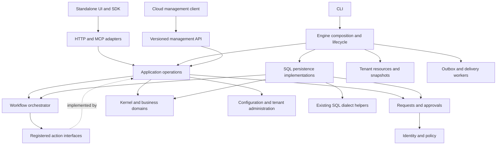

# Kora target architecture and implementation specification

Date: 2026-10-13
Status: target specification; implementation and release gates below are not completed by publishing this file.
Scope: Kora Engine, Kora Cloud, the standalone UI in `kora-studio-mvp` (package name `kora-ui`), the embedded `kora/ui` client, and `kora-ts-sdk`.
Technical names remain `kora`, existing Go import paths, database prefixes, and package names. Product display naming follows `docs/brand-architecture.md`. This restructuring is not a brand migration.

## Contents

- [1. Decisions and completion criteria](#1-decisions-and-completion-criteria)
- [2. Current source and replacement map](#2-current-source-and-replacement-map)
- [3. Domain ownership](#3-domain-ownership)
- [4. Target project structure](#4-target-project-structure)
- [5. Public contract rules and strict types](#5-public-contract-rules-and-strict-types)
- [6. Process and tenant lifecycle API](#6-process-and-tenant-lifecycle-api)
- [7. Database pressure and memory contracts](#7-database-pressure-and-memory-contracts)
- [8. Requests and approvals: contracts, rules, persistence](#8-requests-and-approvals-contracts-rules-persistence)
- [9. Workflow execution specification](#9-workflow-execution-specification)
- [10. Persistence, delivery, configuration and realtime](#10-persistence-delivery-configuration-and-realtime)
- [11. Engine, Cloud, UI and SDK contractual boundaries](#11-engine-cloud-ui-and-sdk-contractual-boundaries)
- [12. Grouped implementation order and desired state](#12-grouped-implementation-order-and-desired-state)
- [13. Required tests](#13-required-tests)
- [14. Target deployment and release procedure](#14-target-deployment-and-release-procedure)
- [15. Purge register and documentation policy](#15-purge-register-and-documentation-policy)
- [16. External behavior used in the design](#16-external-behavior-used-in-the-design)

## 1. Decisions and completion criteria

Build a modular monolith with explicit process and tenant resource ownership. Retain separate tenant databases on shared database servers. Support one self-hosted engine and database without Cloud, NATS, a pooler, or Kubernetes. Add deployment pools only as capacity requires. Cloud manages placement; the engine serves its assigned tenants. A deployment assignment is not a promise of independent failure isolation.

The first business-process delivery is a durable request and approval inbox, integrated with document transitions and a small workflow orchestrator. Do not implement accounting, HR, or procurement suites in this restructuring. Existing modules and configuration packs remain usable through explicit adapters until their replacement gates pass.

Required end state:

1. CLI parses arguments, builds the engine, runs it, and returns errors. It owns no per-tenant worker loops.
2. One tenant runtime authority publishes coherent snapshots and retires old generations. Requests never assemble dependencies from competing registries.
3. All I/O takes context; every worker has an owner, cancellation, and a join path. Cleanup has its own bounded context.
4. SQL, dialect selection, transaction handling, and persistence error handling live in persistence implementations, not HTTP handlers or worker coordination loops.
5. Local and broker delivery acknowledge only the durability boundary they actually reached. Duplicate delivery cannot duplicate committed local effects.
6. Read authorization and field projection apply to resource reads, live events, replay, exports, and request subjects.
7. Requests, decisions, workflow progress, and required audit records survive restart. A notification is not the request record.
8. Public Go and TypeScript contracts remain versioned. No consumer imports engine implementation packages.
9. CPU, memory retained by caches and queues, database connections, and active work are bounded and observable.
10. Documentation describes supported behavior or an explicitly labelled target. No obsolete parallel architecture plan remains authoritative.

This specification was informed by current source inspection, not production profiling or a complete correctness proof. Existing working-tree edits must be preserved. Each implementation group starts by rechecking its cited source against the then-current tree.

## 2. Current source and replacement map

| Current source | Target change | Removal gate |
|---|---|---|
| `cli/serve.go` | Move composition, startup rollback, readiness, and shutdown to `internal/engine` | CLI lifecycle tests use engine API; production wiring has one owner |
| `cli/runtime_context.go` | Replace revision-keyed context ownership with generation-owned runtime handles | Same-revision replacement and cancellation tests pass |
| `net/siterouter.go`, `api/site_services.go` | Route resolution borrows one runtime snapshot; remove opaque service values and second mutable runtime registry | All request and worker callers use acquired handles |
| `auth/session.go` | Tenant-owned session manager with explicit close; remove process-global map keyed by `*sql.DB` | Reload and eviction release managers and goroutines |
| `site/site.go`, `cli/serve.go` pool helpers | Central validated pool allocation in `internal/dbaccess`; cap platform and tenant pools | Every long-lived pool registered against a physical server budget |
| `api/realtime_auth.go`, `api/system.go`, `eventstream/` | Shared read-policy adapter; authorized metadata-first delivery and replay | Local/NATS permission parity tests pass |
| `analytics/worker.go`, `backfill.go`, `bus.go` | Worker coordination separated from SQL store; transactional flush/rebuild; durable retry | Failure injection proves no WAL loss or partial visible rebuild |
| `cli/config_impl.go`, `configstore/` | Restore/export use cases with recoverable persistence | Every persistence failure reaches caller; recovery can finish or restore prior state |
| `api/console.go`, `site/onboarding_store.go` | Tenant administration service owns transitions and recovery | Requested through active/failed state persistence tested |
| `workflow/runtime.go`, `actor.go`, `audit.go` | Retired lease/timer actor runtime; unified Engine v2 definitions and durable process workflow instances are the sole automation runtime | No old runtime, configuration, or history conversion is supported; AI run state remains AI-owned |
| `contract/workflow.go`, `workflow/sqlstore/definitions.go`, `api/views.go`, `kernel/` | Store status policies in Engine v2 definitions and enforce transitions through the canonical record transaction | Pack transition fixtures retain behavior and durable side effects |
| `api/ai_runs.go`, `api/ai/run_store.go` | AI authorization grants remain distinct from business approvals; share inbox projection only | Existing grant binding and replay protections retained |
| `outbox/`, `natsprovider/`, `analytics/local.go` | One delivery contract; local SQL consumer completion and NATS consumer receipts | Restart/redelivery/lease expiry tests pass |
| `ingress/gateway.go`, `cli/site_directory_assign_cell.go` | Deployment ingress owns cross-deployment routing; engine retains local assignment validation | Existing non-default assignments migrated, ingress tested, old client window closed |
| `script/runtime_goja.go`, `scheduler/` | Bounded execution, drain before close, durable scheduled dispatch | In-flight execution and shutdown races tested |
| `storage/local.go` | Atomic file publication and recoverable metadata protocol | Write/rename/sidecar failures never report success |

No table row asserts that the current issue still exists unchanged. Existing fixes are retained and checked; they are not reimplemented by line number.

## 3. Domain ownership

| Domain/package | Owns | Must not own |
|---|---|---|
| `site` | Tenant identity, aliases, status, provisioning and deletion state | HTTP sessions, engine goroutines, commercial billing |
| `configstore`, `doctype`, `schema` | Versioned definitions, validation, activation compatibility, schema plans | User request lifetime, fleet placement |
| `kernel`, `orm` | Authorized record operations and unit of work | Browser state, deployment routing |
| `auth`, new `policy` | Verified actor, tenant membership, operation/read/field decisions | Workflow sequencing or payment accounting |
| new `requests` | Human requests, assignments, responses, history, inbox queries | Business document invariants, email delivery |
| `workflow` | Definition versions, process instances, waits, steps, retries | Direct edits to another domain's tables |
| `scheduler` | Finding due durable work and dispatching it | One goroutine per waiting process |
| Tenant-defined business domains | Their commands, validations, state transitions, authoritative records | Other domains' private tables |
| `analytics` | Authorized reporting projections, retention, rebuild state | Canonical business events or business transaction success |
| `outbox`, `eventstream`, `natsprovider` | Durable publication, receipts, subscriptions, event transport | Approval policy or document field authorization |
| new `notifications` | Delivery attempts and notification preferences | Request completion or approval eligibility |
| `conversation`, application part of `api/ai` | Conversation/run state and authorized tool execution | Blanket authority to mutate records |
| `webhook`, existing provider adapters | External delivery and reconciliation | Claiming exactly-once external effects |
| `internal/engine`, `internal/tenantruntime`, `internal/dbaccess` | Process/resource lifecycle and limits | Business rules and wire schemas |
| `api`, `mcp`, `workspace`, SDKs | Decode/validate transport, invoke use cases, encode responses | SQL, policy duplication, lifecycle ownership |
| `contract` | Versioned public wire types, errors, capability and event vocabulary | DB handles, Gin contexts, worker constructors, domain implementations |

A tenant is the security and data ownership boundary. An organization/legal entity is a business concept within a tenant; existing `org` types must be reconciled before introducing new equivalents. Customer/supplier identities may share a party reference; their commercial rules remain in their own domains. Use existing money/currency representations where present; do not introduce floating-point amounts in new contracts.


## 4. Target project structure

The tree lists responsibility destinations, not a requirement to move every existing file. Keep established packages where ownership is already clear. New internal packages cannot be imported by Cloud or SDKs.

```text
kora/
  main.go                         # CLI entry only
  cmd/contractgen/main.go         # deterministic contract generation/check
  cli/                            # flags, commands, presentation of errors
  internal/
    engine/
      engine.go                   # New, Run, Shutdown, Readiness
      config.go                   # validated process configuration
      assemble.go                 # constructors and reverse-order cleanup
      readiness.go
    tenantruntime/
      manager.go                  # Acquire, Activate, Retire, Close
      snapshot.go                 # immutable config + typed service bundle
      resources.go                # stable tenant resources and generations
      drain.go
    dbaccess/
      manager.go                  # shared physical-server pool budget
      config.go                   # runtime/admin DSNs by opaque reference
      admission.go                # bounded active work and waiters
      metrics.go
    application/
      tenantadmin/service.go      # extraction from console handlers
      configadmin/service.go      # import, export, activation, restore
      ai/service.go               # extraction from api/ai orchestration
      process/actions.go          # binds workflow to domain operations
      process/approval.go         # request decision + domain transaction
    adapters/
      workflowactions/            # registered typed domain action handlers
  contract/
    types.go                      # new opaque wire ID types
    requests.go                   # request/decision DTOs
    workflow.go                   # public workflow DTOs
    deployment.go                 # directory v2 and placement contracts
    management.go                 # Cloud/operator management DTOs
    http_registry.go              # versioned endpoint descriptors
    schema_rules.go               # enum, union and validation metadata
    api/engine-v2.openapi.yaml    # generated API artifact
    schema/                       # generated JSON Schemas
  policy/                         # transport-neutral authorization rules
  requests/
    model.go
    service.go
    policy.go                     # assignment and response policy
    store.go                      # consumer-owned persistence interfaces
    sqlstore/                     # dialect SQL + transactions
  workflow/
    definition.go
    instance.go
    executor.go
    actions.go
    store.go
    sqlstore/
  notifications/
    service.go
    worker.go
    store.go
    sqlstore/
  analytics/
    worker.go
    store.go
    sqlstore/                     # extraction staged to avoid import cycle
  auth/ configstore/ doctype/ db/ kernel/ orm/
  outbox/ eventstream/ natsprovider/ scheduler/ script/
  site/ storage/ secret/ email/ webhook/ conversation/
  api/                            # existing routes retained during migration
    requests.go workflow.go
  net/                            # routing only after runtime extraction
  ingress/                        # compatibility route until Cloud cutover
  mcp/ sdk/ workspace/
  contract-fixtures/
    requests/v2/ workflow/v2/ directory/v2/
  tests/
    architecture/                 # import and contract dependency checks
    integration/                  # cross-module scenarios
  deploy/selfhost/                 # future compose, pooler, backup runbooks
  docs/architecture/
    README.md
    target-state-spec.md
```

Naming: Go packages are short singular concepts except established names and `requests`/`notifications`, which avoid collision with an individual request or notification. Exported methods use domain verbs: `Submit`, `Respond`, `Publish`, `Start`, `Cancel`, `Reassign`, `Acquire`, `Close`. No `ManagerManager`, `BaseService`, `utils`, `common`, or universal CRUD repository. SQL files use `*_postgres.go`, `*_mysql.go`, `*_libsql.go` only where generation differs.

### 4.1 Allowed imports

- `contract` imports standard library and existing small pure serialization/ID dependencies only; no engine domain package.
- Domain model and rule files import standard library and stable contract types, not Gin, `cli`, or `internal/engine`.
- A domain defines the interfaces it consumes. Its `sqlstore` imports the parent domain and `db`; the parent never imports `sqlstore`. Engine assembly constructs both.
- `internal/application/process` may coordinate requests, workflow, kernel, and tenant-defined domain operations; those domains must not import that coordinator.
- Transport imports application/domain public APIs. Only persistence adapters and composition receive `*sql.DB`.
- The normal Cloud Go build imports `contract` and its own HTTP client. It must not import `site`, `kernel`, `orm`, `api`, `net`, or `internal/*` from Engine. A temporary legacy migration adapter may be compiled only under the explicit `kora_legacy_engine` build tag while the separate `KORA_CLOUD_ALLOW_LEGACY_ENGINE_LIFECYCLE` setting remains true; test that build separately and remove it after the production compatibility window passes.
- TypeScript consumers import generated contracts and shared client methods, never backend source snapshots or local definitions of server enums.
- New SQL stores use the existing `db.Dialect` conventions. Split narrower context-aware dialect helpers from the existing doctype-dependent interface as needed; do not create a second SQL dialect registry.

CI checks direct imports mechanically with `go list -json`, excluding vendored/generated frontend dependencies. Include the nested Go SDK module separately. A failed embed build must fail the check or be satisfied by the supported build target; do not call an incomplete `go list -e` graph complete.

### 4.2 Target dependency and ownership graph



Solid arrows show conceptual dependency direction; the dotted edge is an interface implementation, not a reverse Go import. `internal/application/process` binds workflow actions to business operations at composition time. Source import checks, runtime ownership and durable message flow are separate reports; do not infer an exact source graph from this diagram.

## 5. Public contract rules and strict types

Go is the authoritative typed wire model. Generate JSON Schema, OpenAPI, TypeScript definitions and runtime validators deterministically from it using one pinned generator. Schema annotations carry enum sets, tagged-union constraints, size bounds, string patterns (`contract:pattern=`), array item patterns (`contract:itemPattern=`), fixed numeric values (`contract:const=`), and required/null rules not expressible through Go field types alone. Generated output is committed and CI rejects drift. Do not maintain a handwritten second schema as another authority.

Create `cmd/contractgen/main.go` with command `go run ./cmd/contractgen -check` for drift detection and `go run ./cmd/contractgen -write` for regeneration. Reuse the existing `api/openapi.go` registration rather than maintaining two endpoint inventories: move the versioned endpoint descriptors into `contract/http_registry.go` and have the HTTP router/OpenAPI generator reference those descriptors. Keep Go field types and `json` tags authoritative; define enum membership, union constraints and size bounds beside those types in `contract/schema_rules.go`, with generator tests covering each rule. That rule registry contains validation metadata only, not copied DTO field lists.

Generate Engine schema/OpenAPI and a versioned TypeScript artifact bundle with a manifest of schema version, Engine commit and content digests. SDK vendors the released generated bundle into `src/generated/` and re-exports it; Studio and Cloud web pin the SDK contract exports. The generator has a deliberately limited supported type set (scalars, tagged unions, structs, slices, optional pointers and registered schema-bound JSON); unsupported types fail generation. Do not silently emit `any`. Go consumer compatibility is checked against the same fixtures. G0 implements the generation seam; G8 consumes the released bundle.

Existing v1 envelopes, errors, capability names, and routes remain frozen for their compatibility window. New request/workflow APIs use `/api/v2`; changes to existing directory fields use a directory v2 projection. Do not bump unrelated v1 event envelopes because a new endpoint exists. Never emit a changed JSON shape under a frozen version.

### 5.1 Shared values (`contract/types.go`, target)

```go
type TenantID string
type PrincipalID string
type RequestID string
type AssignmentID string
type DecisionID string
type DefinitionID string
type InstanceID string
type StepID string
type OperationID string
type DeploymentID string
type DBServerID string
type IdempotencyKey string
// PageCursor avoids colliding with the frozen v1 contract.Cursor struct,
// which remains used by stream and offline sync clients.
type PageCursor string
type Revision string // decimal uint64 on wire; avoids JavaScript precision loss

type SubjectRef struct {
    Kind string `json:"kind"`
    ID string `json:"id"`
    Revision Revision `json:"revision"`
}
type PageRequest struct {
    Cursor PageCursor `json:"cursor,omitempty"`
    Limit uint16 `json:"limit"`
}
type Page[T any] struct {
    Items []T `json:"items"`
    NextCursor PageCursor `json:"next_cursor,omitempty"`
}
type CommandMeta struct {
    IdempotencyKey IdempotencyKey `json:"idempotency_key"`
    ExpectedRevision Revision `json:"expected_revision,omitempty"`
}
func ParseTenantID(raw string) (TenantID, error)
func ParseRevision(raw string) (Revision, error)
func ValidatePageRequest(p PageRequest) error
```

All ID fields are nonempty bounded opaque strings. Existing tenant IDs are accepted; no silent conversion to a new identifier format. New IDs use existing ULID helpers. Subject kinds use a registered stable name such as `purchase_order`; user input never becomes a SQL identifier without schema resolution. Revisions are canonical base-10 digits, no signs/leading zeroes except `0`; persisted counters use an appropriate integer column. Page limits are 1–100, defaulted to 25 by HTTP decoding. Lists encode as `[]`, not `null`. Dates are UTC RFC3339 strings. Optional pointers distinguish absent values; unknown enum values are rejected on writes. Clients tolerate unknown additive response fields.

IDs have dedicated types to avoid accidental interchange in Go. Add parse/validate functions for every externally accepted ID using the same rules as `ParseTenantID`. Constructors, not caller-supplied JSON, establish authenticated identity.

### 5.2 Authenticated execution (`policy/context.go`, internal domain boundary)

```go
type Execution struct { // unexported fields; cannot be JSON-decoded
    tenant contract.TenantID
    actor contract.ActorContext
}
func (e Execution) Tenant() contract.TenantID
func (e Execution) Actor() contract.ActorContext

type Authenticator interface {
    Authenticate(ctx context.Context, tenant contract.TenantID,
        credential Credential) (Execution, error)
}
type Credential struct { Scheme string; Value string } // never logged/persisted

type ReadPurpose string
const (
    ReadResource ReadPurpose = "resource"
    ReadEvent ReadPurpose = "event"
    ReadExport ReadPurpose = "export"
    ReadRequestSubject ReadPurpose = "request_subject"
)
type ReadDecision struct {
    Allowed bool
    VisibleFields []string
    CanReadHistorical bool
    PolicyRevision contract.Revision
}
type Reader interface {
    DecideRead(ctx context.Context, exec Execution,
        subject contract.SubjectRef, purpose ReadPurpose) (ReadDecision, error)
}
```

Constructors for verified session and service credentials stay in `policy`/auth adapter code. A nonzero actor ID alone is not proof of authentication. Queued work stores actor provenance and a bounded authorization grant reference, not bearer tokens. Execution revalidates tenant membership, grant scope/expiry/revocation, and operation policy. An explicit tenant service principal may perform scheduled work; it has named capabilities, never implicit administrator authority.

Inbound provider callbacks are authentication adapters and must install a stable-tenant, roleless service execution only after validating a provider credential. Apply exact resource-operation grants to that execution; never make a callback trusted by setting legacy `user` or `user_role` context values. Providers without a signed callback must use a tenant-owned opaque callback credential or a verified provider query before any business mutation. Tokenless compatibility paths may remain registered during migration, but must reject writes. Callback credential URL segments must be redacted from Engine and deployment ingress access logs.

`Execution.Tenant()` carries the stable tenant/site ID. `ActorContext.Site` retains the authenticated route name for compatibility with existing Engine audit and session records; adapters validate that route against the pinned runtime separately. A tenant rename must not change the identity used for request ownership, idempotency scope or authorization.

Use existing `contract.Error` and machine codes. Add `RESOURCE_EXHAUSTED`, `STALE_SUBJECT`, `LEASE_LOST`, `OUTCOME_UNKNOWN`, and `UNSUPPORTED_VERSION` with frozen contract fixtures. HTTP mapping: unauthenticated 401, denied 403 (404 when existence is confidential), malformed 400, invalid business input 422, conflict/stale/idempotency reuse 409, capacity 429 or dependency capacity 503, missing 404. Never expose SQL or secrets. Retry advice appears in bounded response metadata and `Retry-After` where applicable.

## 6. Process and tenant lifecycle API

### 6.1 Engine (`internal/engine`)

```go
type Config struct {
    ListenAddress string
    DeploymentID contract.DeploymentID
    StartupTimeout time.Duration
    ShutdownTimeout time.Duration
    TenantLoadConcurrency uint16
    MaxResidentTenants uint32
    MaxRetiringGenerations uint16
}
type Readiness struct {
    Ready bool
    Reasons []string // bounded stable reason codes, not raw errors
}
type Engine struct { /* private owned resources */ }
func New(ctx context.Context, cfg Config) (*Engine, error)
func (e *Engine) Run(ctx context.Context) error
func (e *Engine) Readiness() Readiness
func (e *Engine) Shutdown(ctx context.Context) error
```

`New` validates config and assembles dependencies in a fixed order. It rolls back all acquired resources on failure. No worker runs unowned after it returns an error. `Run` may be called once; it starts registered workers and HTTP serving, blocks, and joins shutdown. Root cancellation is normal completion unless cleanup fails. `Shutdown` is idempotent, concurrent-safe, sets not-ready before draining, and returns aggregated errors. `New` uses a private constructor accepting test dependencies; do not export a bag of arbitrary `any` services.

Startup: validate → establish bounded platform/admin DB access → read directory → initialize shared delivery/storage/telemetry → construct tenant manager → register application services/routes → start workers → bind listener → publish readiness. Tenant discovery is lightweight; tenant activation is lazy with bounded warm-up. A damaged tenant is unavailable individually; shared directory/schema incompatibility blocks process readiness.

Shutdown: mark not-ready → reject new HTTP/job admissions → drain bounded in-flight work → cancel and join consumers/schedulers → finish or abandon fenced claims safely → flush required durable buffers → stop session sweepers/script executors → retire snapshots → close tenant DB pools → close shared broker/platform DB → telemetry last. Close dependencies only after their users exit. Timeout produces nonzero exit and leaves recoverable work; never pretend a live goroutine was safely stopped.

Optional deployment ingress must remain genuinely nil in the supported single-Engine mode when its concrete gateway is absent; do not pass a typed nil gateway through the tenant-ingress interface. Tenant activation and provisioning must work without a cell gateway.

### 6.2 Runtime manager (`internal/tenantruntime`)

```go
type Generation uint64
type Activation struct {
    Tenant contract.TenantID
    ConfigRevision contract.Revision
    DirectoryRevision uint64 // global site-directory feed cursor represented by the snapshot
    ResourceRevision contract.Revision
}
type Snapshot struct { /* immutable registry, policy and typed service references */ }
type Handle struct { /* reference to one generation; release-once state */ }
func (h *Handle) Snapshot() *Snapshot
func (h *Handle) Release()
type Manager struct { /* private generation map and owned resources */ }
func (m *Manager) Acquire(ctx context.Context, tenant contract.TenantID) (*Handle, error)
func (m *Manager) Activate(ctx context.Context, input Activation) (Generation, error)
func (m *Manager) Retire(ctx context.Context, tenant contract.TenantID) error
func (m *Manager) Close(ctx context.Context) error
```

`Activate` privately prepares and validates a complete snapshot, then publishes one pointer under a generation check. Failed preparation leaves the old snapshot live. Same config revision may produce a new generation; old cancellation must not cancel the replacement. Stable resources survive config-only reloads when DB credentials/schema compatibility permit. Resource replacement drains all users before close. Requests/jobs use `defer handle.Release()`. Long-lived subscriptions do not indefinitely pin stale authorization: reauthorize delivery and rotate/close subscriptions when policy changes.

Configuration revision, runtime generation, directory revision, and worker fencing token are different values. Never reuse one as another. Eviction closes idle resources, not durable pending work; the scheduler can reactivate a tenant. Cap resident tenants, simultaneous activations, and retired generations. A failed drain blocks further unsafe replacement and is observable. Until a process-owned durable-work scanner can discover and resume every tenant's due scheduler, outbox, webhook, workflow, and notification work, the runtime manager must reject a cold activation with a retryable capacity error instead of evicting a resident runtime. This is an availability limitation, not a safe-eviction implementation.

The cold-work probe checks the unified process timer table, `_kora_workflow_process_timer`. The former actor/timer runtime is retired and is not initialized, queried, recovered, or migrated.

**Executable-design clarification:** `Activation` carries both the tenant config revision and the global directory cursor because an alias/status/placement update can advance directory state without rebuilding tenant config, while a tenant config update can produce a new runtime generation. When a newer directory cursor carries changed aliases or status at the same config revision, the manager updates that directory projection without rebuilding the tenant registry; status changes with an unchanged cursor are stale. The directory cursor is the SQL feed position, not the tenant config version. Worker fencing tokens stay in each durable worker claim and are validated by that work's persistence store; they are not runtime identities. `ResourceRevision` remains an opaque compatibility identity for stable tenant resources such as a resolved database target and pool allocation.

## 7. Database pressure and memory contracts

### 7.1 Database manager (`internal/dbaccess`)

```go
type PoolPurpose string
const (
    RuntimePool PoolPurpose = "runtime"
    AdminPool PoolPurpose = "admin"
)
type WorkClass string
const (
    Interactive WorkClass = "interactive"
    Background WorkClass = "background"
    Maintenance WorkClass = "maintenance"
)
type PoolKey struct {
    Server contract.DBServerID
    Tenant contract.TenantID
    Purpose PoolPurpose
}
type PoolLimits struct { MaxOpen int; MaxIdle int; IdleTimeout time.Duration }
type ServerBudget struct {
    MaxBackendConnections uint32
    ReservedConnections uint32
    MaxActiveWork uint32
    MaxWaitingWork uint32
    MaxHeavyJobs uint16
}
type Lease struct { /* pinned bounded pool */ }
func (l *Lease) DB() *sql.DB // available only to internal assembly/persistence
func (l *Lease) Release()
type Permit struct { /* release-once admission */ }
func (p *Permit) Release()
type Manager struct { /* server allocations and pools */ }
func (m *Manager) AcquirePool(ctx context.Context, key PoolKey, limits PoolLimits) (*Lease, error)
func (m *Manager) Admit(ctx context.Context, key PoolKey, class WorkClass) (*Permit, error)
func (m *Manager) Close(ctx context.Context) error
```

Assembly resolves DSNs from opaque secret references; no DSNs in directory DTOs or browser responses. Admin and runtime pools have distinct caps and may have different endpoints. Without a pooler, sum allocated pool maxima across replicas plus operational reserve must fit the physical server budget. Maintain a deployment configuration allocation, not an invented distributed semaphore. When configured allocations do not fit, defer activation or reject configuration. Reallocation drains/closes old allocations first. A query permit limits active work but does not free idle connections or enforce a fleet-wide limit on its own.

Admission occurs once around a unit of work, before acquiring its transaction. Nested domain calls reuse the unit of work and do not reacquire permits. Bound waiting by count and deadline; excess work returns a capacity error. Reserve interactive capacity and initially allow one maintenance-heavy job per database allocation. Across replicas, divide this budget or claim a server-scoped durable slot; a process-local limit of one is not a fleet-wide limit of one.

For PostgreSQL, transaction-mode PgBouncer is optional. Pools are per database/user, not globally shared between tenant databases. Set per-database/user limits and account for all pooler replicas. Session-level advisory locks in existing bootstrap/deletion code must use the direct/admin endpoint or session pooling. Statement pooling is not supported. Prepared statements and driver behavior require integration tests against the pinned PgBouncer version.

For MySQL, ProxySQL is optional. Existing `GET_LOCK` use pins connections and must remain on the admin path. Keep distinct tenant credentials and database permissions; do not merge privileges for pooling convenience. A pooler reduces backend connection overhead; it does not remove query/lock/disk limits.

### 7.2 Memory and execution limits

```go
// internal/tenantruntime/budget.go
type TenantLimits struct {
    MaxConcurrentRequests uint16
    MaxConcurrentJobs uint16
    MaxCacheBytes uint64
    MaxQueuedBytes uint64
    MaxEventBytes uint32
    MaxSubscriptions uint32
    MaxScriptConcurrency uint16
    ScriptTimeout time.Duration
}
```

Validate positive limits and aggregate process capacity at startup. Count bytes as well as objects. Cache keys include tenant, permission scope, and config/policy revision; evict on byte pressure and TTL. Queue a durable reference instead of copying full documents where possible. On realtime overflow disconnect with resumable state or require a refetch. Never drop durable business work to preserve a browser connection.

Analytics listener registrations must be capped across the Engine process as well as per tenant. The default process limit is 4,096 and `KORA_ANALYTICS_MAX_SUBSCRIBERS` may set a value from 1 through 65,536. Release a slot only after the listener is removed or its owning tenant generation closes; reject excess registrations and expose active, capacity, and rejection metrics. The separate queued-payload byte admission covers occupied queue slots, not idle channel/runtime overhead.

The per-tenant analytics wake-up queue byte limit and process-wide queued-payload budget are separate settings. `KORA_ANALYTICS_MAX_QUEUED_BYTES` controls the tenant queue; `KORA_ANALYTICS_PROCESS_MAX_QUEUED_BYTES` controls the shared process budget. For existing deployments, Engine may use the former as the process budget when the latter is unset, but new deployment files should set both explicitly.

Go's process memory limit is soft; leave container headroom. Embedded Goja has no proven hard per-tenant RAM limit in the inspected implementation. Bound inputs/concurrency/time and restrict untrusted code accordingly. A future process-isolated executor is a separately tested capability; do not advertise `MaxRAM` as enforcement. Do not create per-tenant sidecars in this pass.

Metrics: pool open/in-use/idle, waits and duration; admission rejects/waits; query duration and lock contention; oldest queued job; resident tenants and retiring generations; cache/queue bytes; goroutines; process heap/RSS; script timeout; worker lease loss. Avoid raw user IDs, request IDs, or every tenant in unbounded metric labels; detailed tenant diagnostics belong in bounded queries/logs.

## 8. Requests and approvals: contracts, rules, persistence

### 8.1 Wire types (`contract/requests.go`)

```go
type RequestKind string
const (
    RequestApproval RequestKind = "approval"
    RequestReview RequestKind = "review"
    RequestInformation RequestKind = "information"
    RequestAcknowledgment RequestKind = "acknowledgment"
    RequestTask RequestKind = "task"
)
type RequestStatus string
const (
    RequestPending RequestStatus = "pending"
    RequestResolved RequestStatus = "resolved"
    RequestCancelled RequestStatus = "cancelled"
    RequestExpired RequestStatus = "expired"
    RequestStale RequestStatus = "stale"
)
type ResponseKind string
const (
    ResponseApprove ResponseKind = "approve"
    ResponseReject ResponseKind = "reject"
    ResponseReturn ResponseKind = "return_for_changes"
    ResponseProvide ResponseKind = "provide_information"
    ResponseAcknowledge ResponseKind = "acknowledge"
    ResponseComplete ResponseKind = "complete"
)
type AssignmentMode string
const (
    AssignmentAny AssignmentMode = "any"
    AssignmentAll AssignmentMode = "all"
    AssignmentSequential AssignmentMode = "sequential"
)
type AssigneeKind string
const (
    AssigneeUser AssigneeKind = "user"
    AssigneeRole AssigneeKind = "role"
    AssigneeGroup AssigneeKind = "group"
)
type Assignee struct {
    Kind AssigneeKind `json:"kind"`
    ID string `json:"id"`
}
type AssignmentSpec struct {
    Mode AssignmentMode `json:"mode"`
    Assignees []Assignee `json:"assignees"`
}
type RequestSource struct {
    InstanceID InstanceID `json:"instance_id,omitempty"`
    StepID StepID `json:"step_id,omitempty"`
}
type SubmitRequest struct {
    Meta CommandMeta `json:"meta"`
    Kind RequestKind `json:"kind"`
    Subject *SubjectRef `json:"subject,omitempty"`
    Title string `json:"title"`
    Message string `json:"message"`
    Assignment *AssignmentSpec `json:"assignment,omitempty"`
    DueAt *time.Time `json:"due_at,omitempty"`
    PolicyID string `json:"policy_id,omitempty"`
    InformationSchema *SchemaRef `json:"information_schema,omitempty"`
}
type RespondRequest struct {
    Meta CommandMeta `json:"meta"`
    AssignmentID AssignmentID `json:"assignment_id"`
    Response ResponseKind `json:"response"`
    Comment string `json:"comment,omitempty"`
    Information *InformationResponse `json:"information,omitempty"`
}
type InformationResponse struct {
    SchemaID string `json:"schema_id"`
    SchemaVersion uint32 `json:"schema_version"`
    Values json.RawMessage `json:"values"`
}
type RequestView struct {
    ID RequestID `json:"id"`
    Revision Revision `json:"revision"`
    Kind RequestKind `json:"kind"`
    Status RequestStatus `json:"status"`
    Requester PrincipalID `json:"requester"`
    Subject *SubjectRef `json:"subject,omitempty"`
    Title string `json:"title"`
    Message string `json:"message"`
    Source *RequestSource `json:"source,omitempty"`
    InformationSchema *SchemaRef `json:"information_schema,omitempty"`
    DueAt *time.Time `json:"due_at,omitempty"`
    AllowedResponses []ResponseKind `json:"allowed_responses"`
    Assignments []AssignmentView `json:"assignments"`
    Outcome *RequestOutcome `json:"outcome,omitempty"`
    ResolvedAt *time.Time `json:"resolved_at,omitempty"`
    Continuation *ContinuationView `json:"continuation,omitempty"`
    CreatedAt time.Time `json:"created_at"`
    UpdatedAt time.Time `json:"updated_at"`
}
type ResponseReceipt struct {
    RequestID RequestID `json:"request_id"`
    DecisionID DecisionID `json:"decision_id"`
    Revision Revision `json:"revision"`
    Status RequestStatus `json:"status"`
    Outcome *RequestOutcome `json:"outcome,omitempty"`
    Continuation *ContinuationView `json:"continuation,omitempty"`
}
type InboxView string
const (
    InboxAction InboxView = "needs_action"
    InboxSent InboxView = "sent"
    InboxWaiting InboxView = "waiting"
    InboxCompleted InboxView = "completed"
)
type RequestFilter struct {
    Page PageRequest `json:"page"`
    View InboxView `json:"view"`
    Kind *RequestKind `json:"kind,omitempty"`
    OverdueOnly bool `json:"overdue_only"`
}
type ReassignRequest struct {
    Meta CommandMeta `json:"meta"`
    AssignmentID AssignmentID `json:"assignment_id"`
    To Assignee `json:"to"`
    Reason string `json:"reason"`
}
type CancelRequest struct {
    Meta CommandMeta `json:"meta"`
    Reason string `json:"reason"`
}
```

Inbox views are filters over current server state: `needs_action` means a pending assignment for the viewer; `sent` means the viewer requested a pending item with no pending assignment for them; `waiting` means the viewer has a blocked or already-responded assignment while the request remains pending; `completed` means a visible terminal request. `overdue_only` further restricts to pending requests with due time at or before the database clock.

`SubmitRequest` does not accept requester, tenant, granted-by, workflow source, or authorization grants from browsers. Source is set by an internal workflow adapter. Governed approvals require a subject and a server-defined policy. Their assignment is computed by policy; a supplied assignment is rejected, not silently trusted. Direct review/task/information requests may accept an assignment after tenant membership and request-creation checks.

**Executable-design clarification:** this shared request package does not define a universal approval-policy table or infer approval rules from DocType CRUD permissions. `PolicyID` is only a reference. The owning business domain must resolve it to a server-owned, versioned policy and supply submission, response, reassignment, cancellation, visibility, eligible-participant, response-kind, and subject-evidence decisions through the `requests.Authorizer` boundary. The domain's policy revision must advance in the same tenant transaction as policy changes and be checked by the request store at commit; membership expansion and response eligibility use the tenant membership revision. A domain with no policy provider must fail closed for governed approvals. The shared service may provide direct user-to-user request mechanics only after tenant membership and the domain's request-creation rules are verified. It must not translate an arbitrary client `PolicyID`, role, or assignment into authorization. This clarification is required because the former contract described a server-defined policy without specifying its owner or persistence boundary, while a generic central policy would move domain invariants into transport infrastructure.

**Direct task policy:** the baseline direct `task` request is a communication action, not a business authorization or record transition. Its server policy may permit an authenticated active tenant user to submit a subject-free task to one or more other active tenant users, with `any`, `all`, or `sequential` assignment. Self-assignment is rejected. This policy confers no permission to read or mutate business records. The request projection is limited to the requester and each recipient's own assignment. A deployment that has not assembled this policy denies task submission; it is never inferred from browser identity fields. Other direct request kinds and every subject-bound request remain domain-policy decisions. For SQL-backed direct tasks, read the tenant authorization revision before reading actor or assignee membership rows and carry that revision into the store commit fence. This ensures a membership revocation between authorization reads and commit cannot be paired with a newer revision and accepted as current.

Title: 1–160 Unicode characters; message/comment/reason: bounded to 8 KiB encoded UTF-8; page 100 maximum; 50 assignees maximum; duplicate assignees rejected. Information requests specify a registered response schema; policy may constrain it. Information payload: 64 KiB maximum, exact requested schema/version, validated before persistence. Other request kinds reject information payloads. Approval accepts approve/reject/return; review accepts complete/return; information accepts provide; acknowledgment accepts acknowledge; task accepts complete/return. Policy may narrow these choices. No arbitrary attachment bytes in request rows. Attachment references use existing storage authorization. `AllowedResponses` is a current projection, never an authorization token.

### 8.2 Service API (`requests/service.go`)

```go
type Service struct { /* private dependencies */ }
func (s *Service) Submit(ctx context.Context, exec policy.Execution,
    cmd contract.SubmitRequest) (contract.RequestView, error)
func (s *Service) Get(ctx context.Context, exec policy.Execution,
    id contract.RequestID) (contract.RequestView, error)
func (s *Service) List(ctx context.Context, exec policy.Execution,
    filter contract.RequestFilter) (contract.Page[contract.RequestView], error)
func (s *Service) Respond(ctx context.Context, exec policy.Execution,
    id contract.RequestID, cmd contract.RespondRequest) (contract.ResponseReceipt, error)
func (s *Service) Reassign(ctx context.Context, exec policy.Execution,
    id contract.RequestID, cmd contract.ReassignRequest) (contract.RequestView, error)
func (s *Service) Cancel(ctx context.Context, exec policy.Execution,
    id contract.RequestID, cmd contract.CancelRequest) (contract.RequestView, error)
func (s *Service) ExpireDue(ctx context.Context, tenant contract.TenantID,
    limit uint16) (uint16, error)
```

`ExpireDue` is internal worker entry, not a public unauthenticated action. Engine injects its scoped service identity and persistence access. Expiry samples the tenant database clock inside its transaction; no process clock is passed because that could make workers on skewed hosts disagree with response and overdue checks. Clock and ID generation for service-created actions remain injected internally for deterministic tests. Responses always recheck current actor authority; a user removed from the tenant cannot respond. Request visibility includes authorized requester, assigned participants, and explicit managers; unrelated users do not receive counts, titles, or events for it. Subject visibility is separately evaluated. If a recipient cannot inspect required evidence, deny assignment or explicitly grant narrow access through domain policy; never auto-grant full record read.

### 8.3 Assignment and state rules

- Request lifecycle: pending → resolved/cancelled/expired/stale. Terminal requests are immutable except append-only history. Resubmission creates a new linked request.
- A decision is a response from a person; fulfillment is a later business operation. Approval does not imply that an external purchase/payment has succeeded.
- Governed approvals default to no self approval. Direct reviews/acknowledgments use their declared policy. Delegation does not erase original assignee or acting identity.
- `any`: first authorized terminal decision resolves the group. `all`: every snapshotted eligible member must approve; one rejection resolves rejected. `sequential`: only the current assignment may act, ordered as persisted. `return_for_changes` resolves the current request and requires a new submission.
- Persist `AssignmentMode` on the request row. Without it, a restarted worker cannot distinguish `any`, `all`, and `sequential` quorum rules from assignment rows alone. Existing rows migrate as `any`; new requests persist the server-authorized mode.
- Role/group targets expand to a bounded participant snapshot at submission. Current membership and eligibility are rechecked on response; the checked versions participate in the commit predicates. A new member is not silently inserted into an existing `all` quorum. If participants become ineligible, a manager must explicitly reassign with an audit reason. Do not silently reduce quorum.
- Reassignment history records both the previous expanded user and the new expanded user, in addition to the acting manager and reason. The assignment row retains its original role/group target; immutable history preserves every subsequent transfer.
- Specification correction after implementation review: the earlier history DTO and table omitted the prior/new assignee, so a reassignment could not prove which participant was transferred after restart. Add nullable previous/new assignee snapshots to v2 history and an additive bootstrap migration; old history entries remain valid with both fields absent.
- Deadlines use database/server UTC, with `now >= due_at` expired. Response and expiration race on the same revision/row; exactly one commits.
- Subject revision/hash binds the decision to the approved content. Response atomically checks the required version with the domain operation or records a decision whose continuation must revalidate before acting. A changed subject rejects the response with `STALE_SUBJECT`; that failed command rolls back. A separate idempotent stale-request reconciler persists the stale transition and its history/outbox. Approval cannot authorize the new content. An implementation must not mark stale inside a transaction that it then rolls back while claiming the state persisted.
- Mark-as-read is a separate per-user receipt, not a request status. Add `MarkRead(ctx, exec, id) error` only to notification/inbox read tracking; it cannot trigger domain operations.
- Request cancellation is allowed by policy and stops future decisions. It does not reverse completed domain actions.

### 8.4 Transaction and store boundary

```go
// requests/store.go; RequestRecord, AssignmentRecord, HistoryEntry are private
// persistence models with explicit tenant, IDs, revision, timestamps and fields
// corresponding to the DTOs; no wire serialization of internal grants.
type RequestRecord struct {
    Tenant contract.TenantID
    ID contract.RequestID
    Revision contract.Revision
    Kind contract.RequestKind
    AssignmentMode contract.AssignmentMode
    Status contract.RequestStatus
    Requester contract.PrincipalID
    Subject *contract.SubjectRef
    Title string
    Message string
    DueAt *time.Time
    Outcome *contract.RequestOutcome
    CreatedAt time.Time
    UpdatedAt time.Time
    PolicyID string
    PolicyRevision contract.Revision
    SubjectDigest string
    InformationSchema *contract.SchemaRef
}
type DecisionRecord struct {
    Tenant contract.TenantID
    ID contract.DecisionID
    RequestID contract.RequestID
    AssignmentID contract.AssignmentID
    Actor contract.PrincipalID
    OnBehalfOf contract.PrincipalID
    Response contract.ResponseKind
    Comment string
    Information *contract.InformationResponse
    At time.Time
}
type DecisionCommit struct {
    Request RequestRecord
    ExpectedRevision contract.Revision
    Decision DecisionRecord
    Receipt contract.ResponseReceipt
    IdempotencyKey contract.IdempotencyKey
    CommandDigest string
    Actor contract.PrincipalID
    Operation string // fixed registered operation, not client input
    ExpectedSubject *contract.SubjectRef
    ExpectedPolicyRevision contract.Revision
    ExpectedMembershipRevision contract.Revision
    Events []contract.EventEnvelope
}
type DecisionStore interface {
    Get(ctx context.Context, tenant contract.TenantID, id contract.RequestID) (RequestRecord, error)
    CommitDecision(ctx context.Context, commit DecisionCommit) (contract.ResponseReceipt, error)
}
```

The store operations are completed in section 8.6; do not expose a generic `Update(map[string]any)`. SQL implementations own transactions and return typed errors. `CommitDecision` atomically performs revision/eligibility predicates supported by persistence, decision insert, request/assignment update, required history, durable continuation event and idempotency receipt. Authorization-dependent state must be checked against a stable version within the transaction; preflight checks alone are insufficient.

Idempotency scope is tenant + authenticated principal + operation + key. Hash canonical validated command data. Same key/same command returns the original receipt after checking current response visibility; same key/different data returns conflict. Keep receipts at least as long as the published retry window; initial minimum is 30 days. Beyond expiry clients must query outcome instead of blindly retrying old commands. Business uniqueness constraints remain the final defense.

For Kernel command receipts, derive the scope from `Execution.Tenant()` and the authenticated principal, command, and caller key. Persist v2 receipts under the stable tenant ID in the existing receipt table's `site` column and look them up by their scoped key inside the isolated tenant database; do not partition them by the mutable route name. During migration, read old route-keyed v2 receipts by their stable scoped key and legacy raw-key receipts only for a matching direct human, command, and actor. If route history yields multiple matching legacy receipts, fail with a conflict for operator reconciliation rather than selecting one. Audit and event `site` fields continue to carry the authenticated route for compatibility.

Cross-domain local actions use a composition-owned unit of work. Engine implements `internal/application/process.Coordinator.ApproveAndApply` for server-registered document workflow transitions. It first calls `requests.Service.PrepareResponse` so response-time authorization and subject checks happen before it asks the supplied tenant transaction opener for a transaction; that opener owns active-work admission. The prepared decision is bound to the request revision, actor, subject snapshot and authorization epochs. A server-owned policy-ID mapping selects the workflow action; the caller cannot supply a command. The coordinator executes `kernel.Kernel.ExecuteInTx` and `PreparedResponse.CommitInTx` on the same transaction, commits once, releases admission, and only then runs post-commit callbacks. Domain packages receive no SQL transaction or service locator. `ExecuteInTx` requires verified execution, performs the ordinary command authorization/validation/idempotency pipeline, writes audit/outbox/receipt rows to the caller's transaction, and returns post-commit work for the owner to run only after successful commit. A same-command retry rechecks current request visibility and returns its receipt before transaction admission, so it cannot rerun the domain effect. The MySQL integration test proves rollback on invalid transition, atomic request/subject commit, and no transaction on replay. This coordinator is an internal capability only: a production business-domain authorization provider and runtime transaction-opener wiring remain required before `requests.approvals.v2` can be exposed. If a target domain cannot participate, commit decision + continuation outbox and return an operation ID; its later action revalidates subject revision and grant. Do not claim atomicity across databases.

**Executable-design correction after kernel transaction review:** the former kernel command entry always opened and committed its own transaction, so it could not atomically coordinate a request decision with a protected domain transition. The new `ExecuteInTx` contract leaves commit ownership with the composition layer and makes the post-commit callback explicit; verified identity is mandatory on this path. ORM reads bind to that transaction to avoid waiting on another connection from a saturated tenant pool. The request/domain coordinator remains gated until both persistence boundaries accept the same transaction.

### 8.5 Storage layout and indexes

All tables live in the tenant database; tenant identity is still validated on every operation and stored in shared receipts where applicable. Kernel receipt v2 uses a dedicated `idempotency_key` index for route-independent lookup; this index is added to existing tenant databases by a versioned bootstrap migration.

| Table | Important keys/indexes | Atomic updates |
|---|---|---|
| `_kora_request` | PK id; status/due_at/id; requester/created_at/id | state, revision, resolution |
| `_kora_request_assignment` | PK id; request_id; assignee principal/status/request_id; unique participant per stage | current stage/decision state |
| `_kora_request_decision` | PK id; unique request_id/assignment_id for final response | immutable response |
| `_kora_request_history` | request_id/sequence unique; nullable previous/new expanded-user snapshots for transfer history | append with state change |
| `_kora_request_read` | request_id/principal_id unique | last-read history sequence |
| existing/new idempotency receipt | tenant/actor/operation/key unique | receipt with effect |
| existing outbox | aggregate key/event ID, ready_at/claim state | enqueue with effect |

Generate DDL using established migrations/dialect helpers. Validate index plans against representative tenant data. Avoid whole-table polling, OFFSET pagination on large inboxes, and total-count queries on every page. Cursor is opaque, scoped to tenant/actor/filter and stable `(created_at,id)` ordering; modification of assignment visibility must not leak previously accessible rows.

### 8.6 Complete assignment, history and persistence interfaces

The following additions are required to make the inbox actionable; request-level allowed responses are only a convenience union of the assignment-level responses.

```go
// contract/requests.go
type RequestOutcome string
const (
    OutcomeApproved RequestOutcome = "approved"
    OutcomeRejected RequestOutcome = "rejected"
    OutcomeReturned RequestOutcome = "returned_for_changes"
    OutcomeProvided RequestOutcome = "information_provided"
    OutcomeAcknowledged RequestOutcome = "acknowledged"
    OutcomeCompleted RequestOutcome = "completed"
)
type AssignmentStatus string
const (
    AssignmentBlocked AssignmentStatus = "blocked"
    AssignmentPending AssignmentStatus = "pending"
    AssignmentResponded AssignmentStatus = "responded"
    AssignmentSuperseded AssignmentStatus = "superseded"
    AssignmentCancelled AssignmentStatus = "cancelled"
)
type AssignmentView struct {
    ID AssignmentID `json:"id"`
    Stage uint16 `json:"stage"`
    Assignee Assignee `json:"assignee"`
    Status AssignmentStatus `json:"status"`
    AllowedResponses []ResponseKind `json:"allowed_responses"`
}
type ContinuationView struct {
    OperationID OperationID `json:"operation_id"`
    State OperationState `json:"state"`
}
type RequestHistoryKind string
const (
    HistoryCreated RequestHistoryKind = "created"
    HistoryAssigned RequestHistoryKind = "assigned"
    HistoryResponded RequestHistoryKind = "responded"
    HistoryReassigned RequestHistoryKind = "reassigned"
    HistoryResolved RequestHistoryKind = "resolved"
    HistoryCancelled RequestHistoryKind = "cancelled"
    HistoryExpired RequestHistoryKind = "expired"
    HistoryStale RequestHistoryKind = "stale"
)
type RequestHistoryEntry struct {
    Sequence Revision `json:"sequence"`
    Kind RequestHistoryKind `json:"kind"`
    Actor *PrincipalID `json:"actor,omitempty"`
    AssignmentID AssignmentID `json:"assignment_id,omitempty"`
    PreviousAssignee *Assignee `json:"previous_assignee,omitempty"`
    NewAssignee *Assignee `json:"new_assignee,omitempty"`
    Response *ResponseKind `json:"response,omitempty"`
    Comment string `json:"comment,omitempty"`
    At time.Time `json:"at"`
}
```

History projection separately redacts comments, acting identities and sensitive evidence. Lists may contain summary requests with only viewer-visible assignments; detail exposes IDs needed for the viewer's authorized actions. Information values are persisted in decision records and returned only through an authorized response detail projection, not in invalidation events. Use this concrete response detail contract; route GET `/api/v2/requests/{id}/responses/{decisionId}`.

```go
// contract/requests.go
type ResponseDetail struct {
    DecisionID DecisionID `json:"decision_id"`
    RequestID RequestID `json:"request_id"`
    AssignmentID AssignmentID `json:"assignment_id"`
    Response ResponseKind `json:"response"`
    Comment string `json:"comment,omitempty"`
    Information *InformationResponse `json:"information,omitempty"`
    At time.Time `json:"at"`
}
// requests/service.go
func (s *Service) GetResponse(ctx context.Context, exec policy.Execution,
    requestID contract.RequestID, decisionID contract.DecisionID) (contract.ResponseDetail, error)
```

```go
// requests/service.go
func (s *Service) History(ctx context.Context, exec policy.Execution,
    id contract.RequestID, page contract.PageRequest) (contract.Page[contract.RequestHistoryEntry], error)
func (s *Service) MarkRead(ctx context.Context, exec policy.Execution,
    id contract.RequestID) error

// requests/store.go
type AssignmentRecord struct {
    ID contract.AssignmentID
    RequestID contract.RequestID
    Principal contract.PrincipalID
    OriginalTarget contract.Assignee
    Stage uint16
    Status contract.AssignmentStatus
}
type WriteIdentity struct {
    Tenant contract.TenantID
    Actor contract.PrincipalID
    Operation string
    IdempotencyKey contract.IdempotencyKey
    CommandDigest string
}
type CreateCommit struct {
    Identity WriteIdentity
    Request RequestRecord
    ExpectedPolicyRevision contract.Revision
    ExpectedMembershipRevision contract.Revision
    ExpectedSubject *contract.SubjectRef
    Assignments []AssignmentRecord
    History contract.RequestHistoryEntry
    Events []contract.EventEnvelope
}
type ReassignCommit struct {
    Identity WriteIdentity
    RequestID contract.RequestID
    ExpectedRevision contract.Revision
    ExpectedPolicyRevision contract.Revision
    ExpectedMembershipRevision contract.Revision
    AssignmentID contract.AssignmentID
    Replacement AssignmentRecord
    Reason string
    Events []contract.EventEnvelope
}
type CancelCommit struct {
    Identity WriteIdentity
    RequestID contract.RequestID
    ExpectedRevision contract.Revision
    ExpectedPolicyRevision contract.Revision
    ExpectedMembershipRevision contract.Revision
    Reason string
    Events []contract.EventEnvelope
}
type VisibilityScope struct {
    Tenant contract.TenantID
    Actor contract.PrincipalID
    CanManageAll bool // derived by policy; never decoded from HTTP
}
type Store interface {
    DecisionStore
    Create(ctx context.Context, change CreateCommit) (RequestRecord, error)
    ListVisible(ctx context.Context, scope VisibilityScope,
        filter contract.RequestFilter) (contract.Page[RequestRecord], error)
    Reassign(ctx context.Context, change ReassignCommit) (RequestRecord, error)
    Cancel(ctx context.Context, change CancelCommit) (RequestRecord, error)
    History(ctx context.Context, scope VisibilityScope, id contract.RequestID,
        page contract.PageRequest) (contract.Page[contract.RequestHistoryEntry], error)
    Response(ctx context.Context, scope VisibilityScope, request contract.RequestID,
        decision contract.DecisionID) (DecisionRecord, error)
    MarkRead(ctx context.Context, scope VisibilityScope, id contract.RequestID) error
    ExpireDue(ctx context.Context, tenant contract.TenantID, limit uint16) (uint16, error)
    MarkStale(ctx context.Context, tenant contract.TenantID, id contract.RequestID,
        expected contract.Revision, observedSubject contract.SubjectRef) error
}
```

`DecisionStore` is the narrow response boundary; `Store` embeds it for the complete request service. This is interface composition over one SQL implementation, not two repository layers.

```go
// requests/service.go
type Clock interface { Now() time.Time }
type IDSource interface { NewID() string }
type SubmissionAuthorization struct {
    PolicyID string
    PolicyRevision contract.Revision
    MembershipRevision contract.Revision
    AssignmentMode contract.AssignmentMode
    Assignments []AssignmentRecord
    ExpectedSubject *contract.SubjectRef
    SubjectDigest string
}
type ResponseAuthorization struct {
    PolicyRevision contract.Revision
    MembershipRevision contract.Revision
    ExpectedSubject *contract.SubjectRef
    SubjectDigest string // current live subject content hash when subject-bound
}
type ManagementAuthorization struct {
    PolicyRevision contract.Revision
    MembershipRevision contract.Revision
    Replacement *AssignmentRecord // resolved, current eligible user for reassignment
}
type Projector interface {
    Request(ctx context.Context, exec policy.Execution, record RequestRecord) (contract.RequestView, error)
    History(ctx context.Context, exec policy.Execution, record RequestRecord,
        entry contract.RequestHistoryEntry) (contract.RequestHistoryEntry, error)
    Response(ctx context.Context, exec policy.Execution, record RequestRecord,
        decision DecisionRecord) (contract.ResponseDetail, error)
}
type ResponseSchemas interface {
    Registered(ctx context.Context, ref contract.SchemaRef) error
    Validate(ctx context.Context, ref contract.SchemaRef,
        response contract.InformationResponse) error
}
type Authorizer interface {
    Submission(ctx context.Context, exec policy.Execution,
        cmd contract.SubmitRequest) (SubmissionAuthorization, error)
    Response(ctx context.Context, exec policy.Execution, request RequestRecord,
        cmd contract.RespondRequest) (ResponseAuthorization, error)
    Management(ctx context.Context, exec policy.Execution, request RequestRecord,
        operation string, command *contract.ReassignRequest) (ManagementAuthorization, error)
    Visibility(ctx context.Context, exec policy.Execution) (VisibilityScope, error)
}
func NewService(store Store, authorizer Authorizer, projector Projector,
    responseSchemas ResponseSchemas, clock Clock, ids IDSource) (*Service, error)
// requests/sqlstore/store.go
func New(database *sql.DB, dialect db.Dialect) (*Store, error)
```

**Executable-design correction after service implementation review:** the original constructor example omitted two required dependencies: `Projector` applies current request/history/response field visibility, and `ResponseSchemas` verifies that information responses use a registered schema. The service requires both; returning raw SQL records or accepting unregistered response schemas would violate the read-projection and typed-payload requirements above. The original `ResponseAuthorization` example also lacked a live subject content digest. Subject-bound responses must match both the persisted subject reference and digest before a decision is recorded; any local domain effect still revalidates the subject in its transaction, and an external continuation must revalidate or reconcile before applying its effect. The management authorization result carries the current policy/membership revisions and an authorized replacement participant. If a direct request includes an assignment choice, the service verifies that its mode and targets match the server-authorized expanded snapshot; omitted assignment selection remains available when server policy supplies it.

`NewService` and SQL `New` reject nil dependencies. SQL store methods are context-aware and never open another database connection inside an existing unit of work. For direct requests without a subject, the expected subject is nil; for governed approval it is required.


Authorization revisions must be maintained by the same tenant transaction authority as decisions, or an explicit serialized policy boundary must provide equivalent guarantees. If an identity source is external, reflect verified membership changes into tenant authorization state; do not pretend an external API read is atomically coupled to SQL. Each store write revalidates predicates under its transaction. SQL stores return private records; the service always projects them through current read/field policy before returning wire views.

## 9. Workflow execution specification

Status-transition policies are optional lifecycle data on Engine v2 workflow definitions, stored and versioned with the unified workflow definition store. Record-triggered automations use the same definition model and durable execution runtime. The kernel enforces transition roles, conditions, required fields, and edit restrictions in the record transaction; generic writes cannot change a protected workflow-state field. AI run approvals remain operation authorization grants bound to tool, target, argument hash, session, and expiry; they are not converted into purchase approvals. A normal record create or update may execute directly when the authenticated user explicitly requested it; the shared kernel still enforces tenant permissions, domain validation, idempotency, audit, outbox, and workflow policy. Do not treat an exploratory question as create/update intent. Privileged configuration writes retain their approval/recent-auth gates.

AI runs, steps, tasks, messages, tool grants, and provider outcomes remain AI-owned records. The former document lifecycle workflow format and actor/timer execution runtime are retired; Engine does not read, migrate, or recover their definitions or execution history. Tenant workflow-store initialization drops the retired `_kora_workflow_audit`, `_kora_workflow_timer`, and `_kora_workflow_actor` tables. Durable automations use the unified versioned definition and instance stores.

### 9.1 Definition types (`contract/workflow.go`)

```go
type StepKind string
const (
    StepAction StepKind = "action"
    StepCondition StepKind = "condition"
    StepHuman StepKind = "human"
    StepWait StepKind = "wait"
    StepEnd StepKind = "end"
)
type ActionSpec struct {
    Name string `json:"name"`
    Version uint32 `json:"version"`
    InputSchema string `json:"input_schema"`
    Input json.RawMessage `json:"input"`
    Next StepID `json:"next"`
}
type ConditionSpec struct {
    Expression string `json:"expression"`
    IfTrue StepID `json:"if_true"`
    IfFalse StepID `json:"if_false"`
}
type HumanSpec struct {
    Request HumanRequestTemplate `json:"request"`
    Outcomes map[ResponseKind]StepID `json:"outcomes"`
    OnExpired StepID `json:"on_expired"`
    OnCancelled StepID `json:"on_cancelled"`
    OnStale StepID `json:"on_stale"`
}
type WaitSpec struct {
    EventType string `json:"event_type,omitempty"`
    CorrelationField string `json:"correlation_field,omitempty"`
    TimeoutSeconds uint32 `json:"timeout_seconds"`
    OnEvent StepID `json:"on_event,omitempty"`
    OnTimeout StepID `json:"on_timeout"`
}
type EndSpec struct { Outcome string `json:"outcome"` }
type StepDefinition struct {
    ID StepID `json:"id"`
    Kind StepKind `json:"kind"`
    Action *ActionSpec `json:"action,omitempty"`
    Condition *ConditionSpec `json:"condition,omitempty"`
    Human *HumanSpec `json:"human,omitempty"`
    Wait *WaitSpec `json:"wait,omitempty"`
    End *EndSpec `json:"end,omitempty"`
}
type WorkflowDefinition struct {
    ID DefinitionID `json:"id"`
    Version uint32 `json:"version"`
    Entry StepID `json:"entry"`
    Steps []StepDefinition `json:"steps"`
}
type InstanceStatus string
const (
    InstanceReady InstanceStatus = "ready"
    InstanceRunning InstanceStatus = "running"
    InstanceWaiting InstanceStatus = "waiting"
    InstanceRetrying InstanceStatus = "retrying"
    InstanceCompleted InstanceStatus = "completed"
    InstanceCancelled InstanceStatus = "cancelled"
    InstanceFailed InstanceStatus = "failed"
    InstanceUncertain InstanceStatus = "outcome_unknown"
)
type StartWorkflow struct {
    Meta CommandMeta `json:"meta"`
    DefinitionID DefinitionID `json:"definition_id"`
    DefinitionVersion uint32 `json:"definition_version"`
    Subject SubjectRef `json:"subject"`
}
type WorkflowInstance struct {
    ID InstanceID `json:"id"`
    Revision Revision `json:"revision"`
    DefinitionID DefinitionID `json:"definition_id"`
    DefinitionVersion uint32 `json:"definition_version"`
    Subject SubjectRef `json:"subject"`
    Status InstanceStatus `json:"status"`
    CurrentStep StepID `json:"current_step"`
    NextWakeAt *time.Time `json:"next_wake_at,omitempty"`
    CreatedAt time.Time `json:"created_at"`
    UpdatedAt time.Time `json:"updated_at"`
}
```

`StepDefinition` is a strict tagged union: exactly one nonnil member matching `Kind`; reject unknown members, duplicate IDs and unreachable/missing destinations. Generated TypeScript uses discriminated unions, not five optional properties. Reject cycles in initial definitions; later loops require explicit bounded semantics. Initial bounds: 100 steps, 64 KiB per action input, 1 MiB whole definition, 100 condition AST nodes, no expression I/O. Validate registered action/schema versions, trusted action grant declarations and service-identity grant availability, outcome coverage and timeout destinations before publication. Grants are trusted registration metadata, never workflow JSON. A definition reference cannot enlarge the grant set.

Expressions use the existing expression AST/evaluator with a restricted pure environment; do not invent another expression language. At the start of G6 implementation, the shared `expression` package had an AST/evaluator but no source parser, despite this requirement. A bounded parser was added to that package (8 KiB source, node/depth caps, closed pure function set); aggregate and unknown function calls are rejected because they can invoke I/O through `Scope.Aggregate`. `map[ResponseKind]StepID` is intentional schema-validated finite routing data, not arbitrary command content. Wait correlations are registered fields and tenant-scoped; they cannot reference raw SQL or arbitrary event payload paths. Event receive and timeout races advance an instance once.

**Executable-design correction for condition read authorization (2026-10-16):** A service-authenticated condition scope must carry an exact `read` grant for the instance's subject kind before the provider is called. A workflow service cannot satisfy an owner-only grant from the recorded starter or assignee, because those identities are audit/assignment data, not current authentication; such grants are denied for condition evaluation. The condition provider must additionally re-read the current subject at the pinned revision and project only current-policy-visible fields, excluding hidden/password fields. This closes the prior gap where the handler checked only that the identity was a service principal and delegated all authorization to an unimplemented provider.

The Engine-owned tenant provider now implements the safe baseline scope as `doc.<fieldname>` for visible scalar fields plus `doc.name`, `doc.doc_status`, and `doc.revision`. Table fields, hidden/password fields, unqualified names, owner metadata, and aggregates are not exposed. A changed subject revision returns `STALE_SUBJECT`; definitions that need richer scope data require a separately registered provider with an equally explicit projection and bounds.

Deterministic condition failures (invalid identity/grant, missing subject, stale revision, invalid expression/result) must commit a terminal failed instance with a bounded reason and event; they must not be released into an endless claim/retry loop. Context cancellation and transient persistence/provider failures remain retryable and do not create a terminal failure.

**Executable-design correction for event correlation:** the former `WaitSpec` identified only an event type and field, leaving the comparison value undefined. For this release, `CorrelationField` is a registered top-level string property of `EventEnvelope.Data`; its exact value must equal the waiting instance's stable `Subject.ID`. The route-level `EventEnvelope.Site` is not the stable tenant key, so trusted consumers supply the tenant identity from their tenant-scoped delivery context. Signal rows are unique by tenant and event ID; a per-instance receipt allows one event to wake multiple matching instances once. Signal acceptance and wait registration both consult the durable inbox, closing their race. The extractor rejects non-object data, missing/non-string fields, and values above 512 bytes; it never traverses arbitrary payload paths. This precise matching rule corrects the prior underspecified `AcceptSignal` wording without accepting browser-supplied correlation values. The inbox stores at most 512 unexpired envelopes per tenant, each at most 64 KiB, and expires signals after 31 days (the maximum wait duration). At capacity it returns `RESOURCE_EXHAUSTED`; the transactional outbox receipt rolls back so delivery remains retryable. Expiration cleanup is bounded to 100 rows per worker pass. Duplicate identity compares canonical typed envelopes after decoding because MySQL JSON columns normalize the stored representation.

The contract generator also initially emitted ordinary object interfaces for this union and did not support JSON Schema `oneOf` or finite enum-key object validation. It now emits strict discriminated unions and a runtime one-of check, and emits a finite key schema for `map[ResponseKind]StepID`. This correction is required for generated TypeScript consumers to reject malformed step variants consistently with Go validation.

The definition store holds immutable tenant-scoped `(definition_id, version)` rows with semantic content digests and actor-scoped publish idempotency receipts. Workflow execution persistence adds tenant-scoped instances, attempts, process timers, event inbox, receipts, and history. Process wakeups live in `_kora_workflow_process_timer`; Engine does not initialize or inspect the retired actor timer table. MySQL's signal-correlation index uses a 191-character prefix because a full 512-character correlation value would exceed InnoDB's composite key limit under utf8mb4; lookup still compares the full value. Starting a workflow checks the immutable definition digest and current subject authorization, then writes the instance, start history, scoped idempotency receipt and data-minimal `kora.workflow.started` outbox event in one transaction; retry returns the existing instance and emits no duplicate event. Instance reads are tenant-scoped and reauthorize the subject. Concurrent starts can deadlock while acquiring absent-key locks; retry only dialect-classified serialization/deadlock conflicts with bounded exponential delay, then resolve the committed receipt. Do not retry validation, permission, immutable-version or other permanent failures.

A human step uses a reusable template, not a submission command:

```go
// contract/workflow.go
type SubjectBinding string
const SubjectInstance SubjectBinding = "instance_subject"
type SchemaRef struct {
    ID string `json:"id"`
    Version uint32 `json:"version"`
}
type HumanRequestTemplate struct {
    Kind RequestKind `json:"kind"`
    Subject SubjectBinding `json:"subject"`
    Title string `json:"title"`
    Message string `json:"message"`
    PolicyID string `json:"policy_id,omitempty"`
    Assignment *AssignmentSpec `json:"assignment,omitempty"`
    DueAfterSeconds uint32 `json:"due_after_seconds"`
    InformationSchema *SchemaRef `json:"information_schema,omitempty"`
}
```

The executor derives subject, workflow source, absolute deadline and stable submission idempotency key from the instance and persisted step execution. Retries reuse that deadline/key; they do not reset the approval clock. No definition embeds an authenticated actor or execution command metadata. Workflow-originated human submission is a separate domain authorization entry point from public user submission: it accepts only a verified tenant workflow service identity, the runtime-derived `(instance_id, step_id)` source, and an exact registered request-policy grant. It must not relax the human-identity requirement on public submission. Each request policy resolves active assignments, subject revision/digest and allowed responses from current domain policy; unsupported request kinds fail closed at validation/authorization rather than inheriting the public path. Human waits advance only on a resolved request outcome, not an individual response while an all/sequential quorum remains pending. Definitions must specify destinations for expired, cancelled and stale requests; an end step can express termination. Consume the request terminal event once under the instance revision/fence. Response/expiry/cancel/stale races cannot leave a workflow waiting forever or advance it twice.

The default Engine workflow authorizer rechecks the active human tenant member's roles from `_kora_user` for every management operation; roles captured in a session are not authoritative. Publishing requires `write` on the virtual `Workflow Definition` resource. Starting requires `read` on `Workflow Definition`, `create` on `Workflow Instance`, and current subject `read`; owner-only subject permission compares the live record owner to the authenticated actor. A start is rejected if the requested subject revision is no longer current. Instance reads require current subject read access. The original starter may cancel a readable instance; an operator with `cancel` on `Workflow Instance` may cancel any readable instance. Reconciliation requires `write` on `Workflow Instance` plus current subject read access. Domain-specific definitions/actions may impose stricter policy.

The SQL authorization store reads subject data and owner in one transaction using the driver's default transaction mode. LibSQL's supported HTTP transport rejects `sql.TxOptions{ReadOnly:true}`; this operation itself issues only `SELECT`s, so omitting that unsupported hint preserves read-only behavior and snapshot consistency without changing the authorization boundary.

### 9.2 Execution API and action boundary

```go
// workflow/service.go
type Service struct { /* private store, authorizer, catalog */ }
func (s *Service) Validate(ctx context.Context, exec policy.Execution,
    definition contract.WorkflowDefinition) (contract.ValidationResult, error)
func (s *Service) Publish(ctx context.Context, exec policy.Execution,
    definition contract.WorkflowDefinition, key contract.IdempotencyKey) (contract.DefinitionVersionRef, error)
func (s *Service) Start(ctx context.Context, exec policy.Execution,
    cmd contract.StartWorkflow) (contract.WorkflowInstance, error)
func (s *Service) Get(ctx context.Context, exec policy.Execution,
    id contract.InstanceID) (contract.WorkflowInstance, error)
func (s *Service) Cancel(ctx context.Context, exec policy.Execution,
    id contract.InstanceID, cmd contract.CancelWorkflow) (contract.WorkflowInstance, error)

// workflow/actions.go
type ActionKey struct { Name string; Version uint32 }
type ActionInput struct { Schema string; Data json.RawMessage }
type ActionResult struct { Schema string; Data json.RawMessage }
type ActionContext struct {
    Execution policy.Execution
    InstanceID contract.InstanceID
    StepID contract.StepID
    IdempotencyKey contract.IdempotencyKey
}
type Action interface {
    Execute(ctx context.Context, action ActionContext, input ActionInput) (ActionResult, error)
}
type ActionClass string
const (
    ActionLocal ActionClass = "local_transaction"
    ActionExternal ActionClass = "external"
)
type ActionRegistration struct {
    Key ActionKey
    Class ActionClass
    InputSchema contract.SchemaRef
    OutputSchema contract.SchemaRef
    // Exact service-operation grant required to enter this registered action.
    // It is trusted assembly metadata and is never accepted from a definition.
    RequiredGrant policy.Grant
    External Action
    Local LocalActionExecutor
}
type Catalog struct { /* immutable map after assembly */ }
func NewCatalog() *Catalog
func (c *Catalog) Register(registration ActionRegistration) error
func (c *Catalog) Resolve(key ActionKey) (ActionRegistration, error)
func (c *Catalog) Freeze() error
```

Each action adapter decodes a registered concrete command (`ApprovePurchaseOrder`, etc.) and invokes the owning domain. Dynamic JSON exists only at this schema-bound dispatch edge. Domain command implementations have concrete inputs; they never accept arbitrary field updates to bypass invariants. Duplicate registrations fail assembly. Exactly one of External/Local must be set and match Class. Freeze requires a valid, exact `RequiredGrant` for each registration and rejects duplicate or incomplete action bindings; further registration fails, and execution cannot start before Freeze. Engine assembly verifies the tenant workflow service identity currently holds every registered grant; the executor checks the exact grant again before dispatch. Definitions cannot select arbitrary Go symbols, SQL, URLs, shell commands, or grants. Engine mints a verified `PrincipalService` identity per tenant from explicit workflow `ServiceGrants` plus grants derived from registered action metadata. Its stable actor identity is `kora-workflow-runtime`; it has no user, delegation, or roles. An early injected identity-provider field remains source-compatible during migration, but Engine validates its tenant/site/service binding and narrows each execution to that same trusted grant set. The worker receives its `policy.Execution` from this assembly-owned provider. It must not reconstruct identity from workflow JSON or treat the initiating actor recorded in audit history as current authentication. Each action still applies current domain authorization to its typed command and subject; the service grant only authorizes entry to that registered operation. In particular, built-in document transitions must keep current-state, condition and required-field validation; a service grant must not be converted into a synthetic human role or bypass those domain checks. This is an executable-design correction (2026-10-16): the initial `ActionRegistration` example omitted the exact grant metadata required by the validation rule, and the existing kernel transition path separately enforced role membership. Without the field and enforcement boundary, the stated narrow service grant could not be checked safely at registered-action dispatch or distinguished from broad static roles.

**Self-hosted composition:** generic Engine workflow configuration supplies durable human waits, conditions and timers without business grants or domain actions. The executable composition root may register a domain integration that supplies its own request authorizer, exact service grants and governed transition bindings. The Purchase Request integration is currently registered by the CLI application composition root, not by Engine's generic tenant-service or workflow packages; it recomputes current subject revision and human reviewer assignments, and responses execute the registered transition under the verified assignee in the request transaction. Generic record-mutation actions, external providers, arbitrary payload schemas and event-correlation fields remain unavailable unless a trusted domain integration explicitly registers and tests them. Workflow workers, timers, human-wait recovery and terminal reconciliation remain tenant-owned and do not require Cloud or a broker. Definitions remain capability-gated by Engine runtime assembly.

Definition versions are immutable after publish. Instances pin a version. Disable new starts without deleting definitions used by active instances. Upgrading active instances is a separate explicit migration with validation of current steps; it is not part of initial delivery. Rollbacks must retain executors for versions still active.

Workflow cancellation is a distinct, revision-checked command with an idempotency receipt and immutable history. It may cancel ready, retrying or waiting instances, but not a currently running or outcome-unknown action. A waiting instance with a linked pending human request cannot be cancelled directly: the requester or authorized manager must first cancel that request through the request API, after which durable terminal-request recovery resumes the workflow and its declared `OnCancelled` route. This keeps request policy, request history and workflow history in their respective owners and avoids workflow cancellation bypassing request authorization. If cancellation races a claim, the transaction fence permits only one outcome.

### 9.3 Worker/store lease protocol

```go
// workflow/store.go
type Fence uint64
type Claim struct {
    Tenant contract.TenantID
    InstanceID contract.InstanceID
    StepID contract.StepID
    Attempt uint8 // next attempt from persisted per-step history
    Owner string
    Fence Fence
    LeaseUntil time.Time
    Revision contract.Revision
}
type StepCommit struct {
    Claim Claim
    Status contract.InstanceStatus
    NextStep contract.StepID
    NextWakeAt *time.Time
    Result ActionResult
    Events []contract.EventEnvelope
}
type ExecutionStore interface {
    ClaimDue(ctx context.Context, tenant contract.TenantID, owner string,
        limit uint16, lease time.Duration) ([]Claim, error)
    Renew(ctx context.Context, claim Claim, lease time.Duration) (Claim, error)
    CommitStep(ctx context.Context, change StepCommit) error
    Release(ctx context.Context, claim Claim) error
}
type Worker struct { /* store, action catalog, bounded concurrency, clock */ }
func (w *Worker) Run(ctx context.Context) error
```

Claim uses a transaction and compare-and-set or supported locking. The returned attempt is one greater than the last persisted attempt for the instance's current step. Store predicates include owner, fencing token, expected revision, and current lease validity. Lease timestamps use DB time for multi-process authority. Renew cannot revive an expired claim. Stale owners cannot commit, release, mark failed, or delete timers belonging to the new owner. `CommitStep` persists state, step result, history, next timer/subscription, outbox and receipt together. It requires the submitted attempt to match the claim and transactionally verifies it is exactly one greater than the last persisted attempt for that step. Execution and business idempotency identities remain fixed across retries; callers cannot skip, duplicate, reorder, or reset attempts with a new identity.

An action key is derived from tenant + instance + step execution identity, stable across attempts. Persist each attempt separately; retry must not invent a new business idempotency key. The persisted execution ID is the 64-character hexadecimal SHA-256 digest, without an added prefix, to fit the MySQL `VARCHAR(64)` column; the separate idempotency key may use its own namespace prefix. Before an external call, persist a `running` attempt under the current lease fence, then finalize that exact attempt in the fenced step transaction. If its lease expires while the attempt remains `running`, recovery must move the instance and attempt to `outcome_unknown` before any new attempt can start. External calls run outside SQL transactions. A crash after an external success but before local persistence uses provider idempotency or reconciliation. When outcome cannot be determined, set `outcome_unknown` and require a recorded operator action. Never retry a non-idempotent payment blindly.

Initial retries: transient dependency failures only, exponential backoff with jitter, maximum 8 attempts and 24 hours elapsed, overridable by registered action policy. Validation/permission/stale-subject failures do not retry automatically. Lease loss is a worker ownership outcome, not a business rejection. Bound action runtime below lease extension capability; stop initiating effects after cancellation/lease loss. Fencing cannot retract an already-sent external request.

Local business effects require a stronger boundary than an eventual step-status update:

```go
// workflow/actions.go; implementation in internal/application/process
type LocalActionExecutor interface {
    ExecuteLocal(ctx context.Context, claim Claim, actor ActionContext,
        key ActionKey, input ActionInput, next contract.StepID) (ActionResult, error)
}
```

`ExecuteLocal` validates the current claim while holding the instance ownership row lock (or equivalent serializable/CAS protocol), then binds domain repositories to the same tenant transaction. Domain writes, idempotency receipt, step progress, timer/history and outbox commit together. Competing claims cannot supersede ownership during that critical section. Do not execute a local mutation through ordinary `Action.Execute`, commit it, and then discover lease loss in `CommitStep`. The catalog declares local-transactional versus external action class; the executor enforces the matching adapter. External `Action.Execute` remains outside transactions and uses idempotency/reconciliation. Add an integration race that attempts takeover between claim validation and the domain write.

Operator reconciliation is explicit:

```go
// contract/workflow.go
type ReconciliationOutcome string
const (
    ReconcileSucceeded ReconciliationOutcome = "confirmed_succeeded"
    ReconcileNotApplied ReconciliationOutcome = "confirmed_not_applied"
    ReconcileAbandon ReconciliationOutcome = "abandon"
)
type ReconcileWorkflow struct {
    Meta CommandMeta `json:"meta"`
    StepID StepID `json:"step_id"`
    Outcome ReconciliationOutcome `json:"outcome"`
    EvidenceRef string `json:"evidence_ref"`
    Reason string `json:"reason"`
}
// workflow/service.go
func (s *Service) Reconcile(ctx context.Context, exec policy.Execution,
    id contract.InstanceID, cmd contract.ReconcileWorkflow) (contract.WorkflowInstance, error)
// workflow/store.go
type Signal struct {
    Tenant contract.TenantID
    Event contract.EventEnvelope
}
type SignalStore interface {
    AcceptSignal(ctx context.Context, signal Signal) (uint32, error)
    Reconcile(ctx context.Context, tenant contract.TenantID, actor contract.PrincipalID,
        id contract.InstanceID, cmd contract.ReconcileWorkflow) (contract.WorkflowInstance, error)
}
```

Only registered trusted event consumers submit signals; browsers cannot spoof internal events. `AcceptSignal` validates matching tenant, type and correlation, inserts a unique receipt and makes matching instances ready atomically. A signal relevant to an instance not yet waiting is retained in a durable scoped inbox until consumed/expired; wait registration checks that inbox in its transaction. Acceptance serializes through a pre-created singleton row in `_kora_workflow_signal_capacity` in each tenant database before pruning, counting, and inserting, so concurrent deliveries cannot exceed the retained-inbox row limit and first-use deliveries do not contend on a missing-row insert. Reconciliation requires privileged recovery policy, evidence and expected revision; it writes immutable audit/history and next work in one transaction. Its idempotency receipt is scoped to tenant and verified recovery actor, and replay must match the original command digest. The transaction checks the instance revision, uncertain status and action step, then increments the worker fence and clears its lease and timer. Confirmed success advances along the registered success edge; confirmed-not-applied returns to the same action step with the original business idempotency key; abandon records a failed terminal instance. Unknown evidence cannot be converted into success by ordinary users. Engine system bootstrap v13 installs the reconciliation receipt table on existing tenant databases before reconciliation is enabled. Bootstrap v14 adds event-wait subscription and per-instance signal-receipt tables on existing tenant databases before event waits are enabled. Bootstrap v15 adds and seeds the singleton signal-capacity lock row table on existing tenant databases, serializing concurrent signal admissions before enforcing the inbox bound.

### 9.4 Durable tables and wake-up behavior

Use versioned definitions, instances, step attempts, timers/event subscriptions, and existing outbox/receipt tables. Unique constraints include `(definition_id,version)`, `(instance_id,step_execution_id,attempt)`, and consumed event identity. Due index covers status/next_wake_at/id. A waiting instance holds no goroutine, DB connection, or transaction. SQL polling is batched with idle backoff and jitter. A process-owned scheduler sweeps all locally assigned tenant IDs in bounded pages, briefly acquiring pools for dormant tenants and checking indexed due work. Persist its sweep cursor and expose maximum sweep lag; size the interval against the declared deadline SLO. An optional platform next-wake index is only a rebuildable hint, reconciled by full sweeps. Eviction never removes a tenant from durable-work discovery. If this sweep cannot meet latency or connection budgets, reduce assignment size or add the hint index before increasing polling concurrency. NATS may wake workers, but restart recovery scans durable SQL state. Human request creation and instance wait registration commit together when in one database; otherwise idempotent creation and a persisted continuation prevent a lost-response race.

## 10. Persistence, delivery, configuration and realtime

### 10.1 SQL and transactions

```go
// db/context.go: add alongside existing Queryer; migrate callers, then remove
// legacy context-free methods only after consumers have moved.
type ContextQueryer interface {
    ExecContext(context.Context, string, ...any) (sql.Result, error)
    QueryContext(context.Context, string, ...any) (*sql.Rows, error)
    QueryRowContext(context.Context, string, ...any) *sql.Row
}
```

Use `BeginTx`, deferred rollback, and checked commit. Close and check rows; propagate scan, iteration, close where material, serialization and write errors with operation context. Every placeholder, upsert, identifier and date expression uses existing dialect conventions. Do not assume MySQL DDL rolls back because it was wrapped in a SQL transaction. Config/schema activation requires a recoverable journal for nontransactional DDL. SQL-generation tests complement real supported database tests; they do not replace them.

### 10.2 Analytics persistence API

```go
// analytics/store.go
type BatchID string
type FlushBatch struct {
    ID BatchID
    Tenant contract.TenantID
    Events []contract.EventEnvelope
}
type RebuildRange struct { Start time.Time; End time.Time } // [start,end), UTC
type Store interface {
    ApplyBatch(ctx context.Context, batch FlushBatch) error
    Rebuild(ctx context.Context, tenant contract.TenantID, span RebuildRange) (uint64, error)
}
```

**AI read-query boundary:** AI may retrieve records through the existing typed `find`, `list`, and `get` tools, or aggregate data through the governed analytics semantic catalog. The AI never supplies SQL, table names, joins, or executable query text. Record reads derive verified execution identity, apply the same read and owner policy as other channels, project only AI-readable fields, and cap pages at 100 rows. Semantic queries select only catalog models, measures, and dimensions; authorization covers every source DocType and rejects owner-scoped aggregate access and hidden/password fields. Validate requests on the Engine even when the model-provider tool schema rejects invalid arguments: at most 5 model queries, 20 selected measures and 20 filters total, 20 values per filter, 256 UTF-8 bytes per value, 200 result rows per model query, and an inclusive ISO date range no longer than 3,660 days. Apply filters before SQL row limits and push limits into the query. This is a bounded semantic query language, not unrestricted database access; adding a field or relationship requires a validated catalog model or authorized domain API.

`ApplyBatch` inserts a receipt for each canonical event ID together with that event's rollup contribution and all batch writes in one transaction. Error rolls back every write. On success worker may acknowledge/remove the rotated WAL. A crash after commit and before removal replays the same event IDs; committed receipts suppress those event contributions while still allowing WAL acknowledgment. A batch ID is not a stable replay identity because bounded WAL scans may partition the same durable events differently after restart. Preserve unreadable/corrupt WAL for diagnosis; never acknowledge a truncated record as processed. Local WAL sync/rename/directory-sync behavior must be explicit and fault-tested if it remains a durability authority.

**Analytics receipt correction:** use `(tenant, event_id)` receipts rather than a batch receipt. The local worker's batch boundaries are an execution detail and can change across retries, while event IDs remain stable. Keep each event's contribution associated with its ID until commit so a duplicate receipt skips only that event's rollup/workflow effects. Receipt insertion, accepted contributions, and workflow transitions share one SQL transaction; WAL acknowledgment follows commit.

**Analytics receipt/checkpoint retention gate:** do not age-delete `_kora_analytics_event_receipt` rows or rebuild checkpoints while a corresponding replay source can still redeliver events or resume from an older source sequence. Current local WAL recovery files, durable outbox history, broker redelivery, and restored backups do not share one enforced maximum replay horizon; applying an arbitrary analytics retention period would reopen duplicate rollup effects or lose rebuild range filtering. Until G3 supplies a coordinated source-retention contract and proves its cutoff against WAL, outbox, broker, and backup recovery, retain receipts and checkpoints. Retention of daily/monthly projections and event detail is independent and must not be presented as bounding these correctness records.

Analytics WAL directories must be keyed by stable tenant ID, never by mutable route/site name. On startup, migrate recognized legacy name-keyed directories to the stable tenant namespace before workers start. Resolve legacy directory names through the current canonical name and registered aliases. Preserve event bytes and fail startup without changing pending data if a legacy path has no current owner, if an unpartitioned root WAL is pending, or if both old and stable paths contain pending events; never merge unordered WAL streams. Operators must recover/map an unrecognized legacy path before retrying startup. Temporary `.wal-ack-*` rewrites are pending WAL and must remain replayable after a crash.

**Analytics rebuild cutoff correction:** persist successful cutoffs by `(tenant, doctype scope, from date)` in the rebuild transaction. A later worker flush reserves each event receipt under the tenant rebuild lock and filters only rollup keys covered by a checkpoint whose sequence includes that event. Keep deltas outside the rebuilt date/doctype scope and workflow-transition effects, because the current source rebuild replaces daily/monthly rollups only. The outbox publisher fills the sequence field from `_kora_outbox.source_sequence` for historical envelopes that predate the payload field; migrated sequence-zero events remain ordered before any positive cutoff.

Prefer SQL outbox plus consumer receipts as the recovery authority for new local workflow/request consumers. Broker publish acknowledgment allows marking publication, not consumer completion. For local SQL effects, the consumer must reserve its unique receipt and apply the effect in the same transaction; insert the receipt before invoking the handler so a duplicate skips the effect, and roll back both on handler/commit failure. Engine's `outbox.Dispatcher.RegisterTransactional` is the local handler boundary. The legacy non-transactional handler remains at-least-once and is for external/idempotent effects only; it cannot promise no duplicate effect across the effect/receipt crash window. NATS durable consumers acknowledge only after handler effects and receipt commit. The consumer must join per-delivery lease-extension work, use a confirmed successful acknowledgment for completed messages, leave messages unsettled on shutdown cancellation, and surface lease-extension, NAK, dead-letter publication, termination, and ACK errors to its owner; an error leaves the delivery retryable rather than claiming completion. Runtime-owned consumers must retry transport/settlement failures with bounded backoff and stop/join on generation cancellation so durable work resumes without a process restart. External effects use an attempt/reconciliation record. Required receipts must not be garbage-collected before their replay/redelivery window ends.

The local SQL `Dispatcher` and external `Publisher` own independent completion facts. Dispatcher queries rows that lack an applicable consumer receipt (including rows already published externally), and never writes `_kora_outbox.status` or `published_at`; only `Publisher` may mark publication after provider acknowledgment. This allows local transactional effects and provider delivery to run in either order without one suppressing the other. Filtered consumers must not create receipts for unrelated event types, and receipt-backed selection prevents completed old rows from starving new local work.

`Rebuild` owns source reads, range replacement and commit inside the analytics persistence boundary. Define a consistent source cutoff and prevent live rollups for the same tenant/range from being lost or double-counted: initial implementation serializes rebuild with that tenant's flush writer using a database row lock held by the rebuild transaction and queues incoming events durably in the outbox/WAL. A durable lock row is sufficient here because the lock is released automatically on transaction rollback or connection loss; no separately renewed lease may outlive the rebuild transaction. The cutoff is a durable monotonic per-tenant source sequence, not the event timestamp; transaction snapshot/source queries must use that same sequence. Snapshot source cutoff excludes later events; replay resumes strictly after that cutoff. Test boundary timestamps, updates and deletes. A failure keeps the previously committed range intact. A future shadow-generation rebuild is optional after measurement.

The source sequence is a canonical nonnegative signed-64-bit decimal string on `EventEnvelope.sequence`, assigned by `outbox.SQLWriter.Append` inside the same tenant transaction as the business write and outbox row. SQL `BIGINT` and the Go allocator are signed, so the usable range is 0 through 9,223,372,036,854,775,807; allocation fails closed at the maximum and never wraps. `_kora_tenant_event_sequence` is the tenant-database-scoped singleton allocator and cutoff source; its row lock serializes allocation independently of mutable route names. `_kora_outbox.source_sequence` remains indexed with the compatibility `site` route field for bounded route-scoped scans. The sequence allocation rolls back with the business transaction. Consumers that need rebuild ordering must use this sequence rather than timestamps or outbox IDs. Existing outbox rows migrate with sequence zero; they are historical and must not be mistaken for newly sequenced source events.

**Source-sequence identity correction from implementation audit (2026-10-15):** `EventEnvelope.Site` is a route/display name and is mutable; it must not key the tenant source sequence. The implementation now uses `_kora_tenant_event_sequence`, a tenant-database-scoped singleton, seeded transactionally from the maximum legacy sequence across route-name rows while holding its row lock. `EventEnvelope.Site` and historical outbox rows remain unchanged. Integration tests prove route changes and legacy seeding on MySQL 8.4.11, PostgreSQL 16 and actual HTTP LibSQL; the tenant database boundary, rather than a caller-supplied event field, is the trusted tenant scope. During release, stop or drain old event writers before enabling new writers; the old allocator does not coordinate on the singleton, so mixed old/new concurrent writes cannot guarantee one monotonic sequence. This correction does not establish a replay-retention floor and does not authorize pruning.

**Self-host backup checkpoint correction from implementation (2026-10-15; tightened 2026-10-16):** `scripts/selfhost-source-manifest.py` records a versioned per-database source-sequence high-water mark while Engine writes are stopped; a valid manifest must contain at least one non-system application database, and restore validation requires each recorded database and rejects a restored value below its checkpoint before Engine starts. Empty manifests fail closed. This proves that a selected backup restored at least its own checkpoint. It is not the global minimum across all restorable backups, and it does not cover local WAL, broker redelivery, or consumer acknowledgment horizons. Therefore it is not the retention floor required for pruning. Keep deletion disabled until backup-set expiry is authoritatively bounded and each replay source participates in a resumable coordinated floor protocol.

**JetStream publish durability correction from implementation audit (2026-10-15):** The outbox publisher marks a row published after the configured `EventPublisher` acknowledges. The Engine previously created `KORA_EVENTS` with `MemoryStorage`, whose acknowledgment could not survive a broker process restart even though the SQL outbox row was already marked published. Newly created event streams now use bounded `FileStorage` with `DiscardNew` and no age expiry; operators must configure a persistent JetStream `store_dir` for restart recovery. JetStream stream storage type is immutable, so bootstrap preserves an existing memory-backed stream as a visible compatibility state instead of deleting it or claiming it was converted. The provider rejects new durable event publishes to that stream with a typed error, leaving the SQL outbox row retryable/visible instead of acknowledging a message that cannot survive broker restart. A tested, consumer-preserving migration of deployed memory streams remains an external release gate; do not retire that compatibility path or claim restart-durable publish semantics for it before the operator migration passes. NATS remains optional and self-host operation without it is unchanged.

**Backup inventory floor implementation note (2026-10-15):** The self-host manifest helper can compute a backup-only per-database floor from the complete set of retained backup manifests, serialize atomic monotonic updates, and validate that a selected restore remains in that catalog. This relies on the operator supplying every restorable copy and verifying retired copies are unavailable. It does not establish the coordinated replay floor: WAL, outbox, consumer receipts, analytics receipts/checkpoints, and broker acknowledgments must still participate before any durable-record pruning is enabled.

**Outbox bootstrap migration ordering correction from real-dialect validation:** For an existing outbox, `CREATE TABLE IF NOT EXISTS` does not add `source_sequence`. Bootstrap must create/confirm the outbox table, add the missing sequence column, and only then create source-sequence indexes and the remaining outbox indexes/tables. Creating the sequence index before the additive column migration fails on existing PostgreSQL tables; keep an upgrade test that preserves historical rows on every supported dialect.

SQL portability correction from implementation: analytics source-table identifiers must be quoted through the active dialect using the unquoted `DocType.RawTableName()` value; `DocType.TableName()` contains MySQL backticks and is invalid for PostgreSQL. Grouped dimension strings use the dialect's supported concatenation operator (`CONCAT` for MySQL and `||` for PostgreSQL/LibSQL). Incrementing conflict updates should use a table-qualified current-row value when the dialect requires it; retain the existing `QueryDialect.UpsertIncrement` method for compatibility and expose a table-qualified optional helper for callers that know the target. Monthly rollup predicates and inserted month keys bind canonical `YYYY-MM-DD` values to avoid timezone conversion when writing SQL `DATE` columns. Read SQL `DATE` values through a driver-neutral parser that accepts native `time.Time`, string, or byte representations, because LibSQL HTTP and server SQL drivers may expose the same column differently. Keep real-dialect rebuild, lease, and flush integration tests because SQL-mock generation checks cannot validate these semantics.

The no-broker HTTP rebuild path persists a job before notification and delegates work to a single worker owned and joined by that tenant runtime. The worker scans durable jobs so a notification lost after commit does not lose work, and it reacquires active-work admission for each rebuild. Rebuild claims use a database-time lease with a monotonically increasing fencing token; heartbeats renew the lease, canceled work rolls back and releases the claim, and expired work can be reclaimed after a process crash. Final job-state writes require the live owner and fencing token. NATS task deliveries are wake-up hints only; the tenant SQL job row remains authoritative and the tenant runner executes rebuilds in broker and no-broker deployments. This bounds each loaded tenant to one rebuild worker per Engine process, while aggregate admission across replicas remains a separate G3 requirement.

### 10.3 Config administration and local storage

```go
// internal/application/configadmin
type RestoreCommand struct {
    Tenant contract.TenantID
    TargetRevision contract.Revision
    ExpectedRevision contract.Revision
    IdempotencyKey contract.IdempotencyKey
}
type RestoreResult struct {
    OperationID contract.OperationID
    ActiveRevision contract.Revision
}
type Service struct { /* config store, schema planner, runtime activator */ }
func (s *Service) Restore(ctx context.Context, exec policy.Execution,
    cmd RestoreCommand) (RestoreResult, error)
func (s *Service) Export(ctx context.Context, exec policy.Execution,
    tenant contract.TenantID, destination string) error
```

Restore journal phases: requested → snapshot_saved → applying → validated → activated → completed; failure stores phase/error and recovery plan. A failed journal write is itself an error; never report successful rollback. Serialize activation against expected revision. Keep the prior snapshot usable until publication. Destructive/nonreversible schema changes require an explicit backup/recovery gate; do not advertise automatic rollback.

Config-version rollback requests carry an idempotency key through the tenant API and journal. Retries replan from live schema so already-applied DDL is not repeated. A rollback restores a quarantined field/table only when exactly one retained candidate matches the target; multiple candidates fail closed for explicit operator selection instead of silently creating an empty replacement. Tenant clients retain the key across a retry, including a page reload when session storage is available.

CLI config import also records the complete parsed snapshot in the tenant config-operation journal before its first tenant-config write. Its operation identity is a tenant-scoped digest of that immutable snapshot, so rerunning the same import resumes interrupted idempotent upserts instead of creating a second operation. Config-version creation and the journal's validated phase commit together; schema migration is replanned from live schema on every retry, and completion is recorded only after migration succeeds. A failed import can therefore be resumed by rerunning the same pack; changing pack contents starts a distinct operation.

Until that restore journal and its recovery executor are active, config activation must not issue irreversible field drops. Removed physical columns are renamed to revision-scoped quarantine names so data remains available for recovery; this alone does not prove that a rollback restored the values. Quarantine cleanup requires a separate retention/backup gate.

Export validates path policy, creates directories with checked errors, serializes before publication, writes temporary files in the destination filesystem, checks flush/close, then renames. Multi-file exports use a staging directory and manifest published last. Local object + metadata sidecar cannot be atomically replaced as two independent files: use a generation directory/manifest pointer or recovery journal. Failed sidecar publication does not return success and leaves recoverable state.

Browser IndexedDB queue changes are successful only after the containing transaction completes; request success alone is insufficient. Surface open, blocked-upgrade, request, transaction-error and abort failures. A failed persistent clear must leave any in-memory fallback queue intact; use in-memory fallback only when IndexedDB is unavailable, not when persistence failed.

### 10.4 Realtime authorization

```go
// eventstream/projection.go
type ViewerProjector interface {
    Project(ctx context.Context, exec policy.Execution,
        event contract.EventEnvelope) (contract.EventEnvelope, bool, error)
}
```

`bool=false` means not deliverable. Both local and NATS live/replay call the same projector before writing bytes. Reauthorize tenant, read permission, owner restrictions and field visibility. Metadata-only invalidation is the default; even record existence and field names can be sensitive. Full state/old values require explicit current and historical access, never only topic subscription. Ownership transfer must not expose an old owner's history to the new owner automatically. Deletes without enough evidence fail closed. Permission lookup errors fail closed.

Cursors are opaque and scope-bound. A revoked user cannot replay old data using a saved cursor. Queue overflow closes/restarts the stream; clients refetch authorized state. Maintain a separate durable consumer path for analytics/workflow; a browser buffer is never the authoritative delivery source.

### 10.5 Notification delivery boundary

Notifications consume committed request/workflow events and create recipient-specific delivery attempts. The request remains discoverable through the inbox even if every delivery channel fails. Resolve recipient permission again before rendering content. Email should contain a minimal action link unless policy explicitly allows sensitive content.

```go
// notifications/service.go
type NotificationID string
type Channel string
const (
    ChannelInbox Channel = "inbox"
    ChannelEmail Channel = "email"
    ChannelPush Channel = "push"
)
type Delivery struct {
    ID NotificationID
    Tenant contract.TenantID
    Recipient contract.PrincipalID
    RequestID contract.RequestID
    Channel Channel
    EventID string
    Attempt uint16
}
type DeliveryResult struct {
    ProviderReference string
    AcceptedAt time.Time
}
type Sender interface {
    Send(ctx context.Context, delivery Delivery) (DeliveryResult, error)
}
type Service struct { /* event receipt and delivery store */ }
func (s *Service) Consume(ctx context.Context, event contract.EventEnvelope) error
type Worker struct { /* bounded claims, sender, retry policy */ }
func (w *Worker) Run(ctx context.Context) error
```

`Consume` atomically records its event receipt and delivery rows, unique by tenant/event/recipient/channel. Sender success means provider acceptance, not proof a human read the message. Delivery attempts use the same claim/fence discipline as outbox workers. No notification provider imports request SQL tables or resolves request state itself. Existing email/webhook adapters implement delivery behind this boundary; do not create duplicate SMTP clients.

## 11. Engine, Cloud, UI and SDK contractual boundaries

### 11.1 Cloud management API

Cloud owns commercial accounts, subscriptions, deployment intent, regions, provisioning requests and progress. Engine owns tenant business data, actual schema/config activation, identity enforcement, request/workflow execution, and observed runtime status. Self-hosted operators invoke the same Engine use cases through CLI without Cloud.

The authenticated management API exposes `GET /api/management/v2/capabilities`, returning `contract.ManagementCapabilitiesV2` with only the operations registered by the running Engine's durable worker composition. Cloud checks the typed capability response before persisting a provisioning intent and requires `tenant.provision`, `tenant.provision.reconcile`, `tenant.invitation.deliver`, and `operation.read`; Engine advertises invitation delivery only when its SMTP provider is configured. When the selected template requires a managed package, Cloud also requires `tenant.package.apply` and `tenant.package.reconcile` and asks Engine to validate that immutable package before tenant creation. Static Cloud configuration alone is not evidence that Engine enabled the operation. Capability discovery does not probe or alter tenant state. Existing tenant business requests do not depend on Cloud availability.

Create `contract/management.go` and a supported `sdk/management` Go HTTP client. Initially these remain in the existing Engine contract/SDK module structure; Cloud still depends on the root Go module to import `contract`, and the nested SDK pins that root contract version. Engine must not import the nested SDK, avoiding a module dependency cycle; extracting a separate contracts module requires a separate release plan, not a module move hidden in this pass.

The shared marketplace artifact DTOs (`contract.MarketplacePackageManifest`, `contract.PackFile`, and their nested manifest/validation types) and the pure canonical-manifest/artifact-digest algorithms belong to the public contract package. Engine's legacy `site` type/function wrappers remain source-compatible during consumer migration; package parsing and tenant configuration activation remain Engine-owned behavior and move behind the management API before Cloud removes its remaining validation adapter.

Marketplace package file types also include `report` at `reports/*.yaml`. This is a bounded declarative analytics definition parsed by Engine and stored in the configuration snapshot; it does not permit package SQL or a Cloud-owned report executor. This closes a mismatch found during template implementation: filesystem imports already preserve governed report definitions, while the marketplace package validator/import path previously rejected them, which would silently leave published templates without their declared reports.

```go
// contract/management.go
type OperationState string
const (
    OperationRequested OperationState = "requested"
    OperationRunning OperationState = "running"
    OperationSucceeded OperationState = "succeeded"
    OperationFailed OperationState = "failed"
    OperationRecoveryRequired OperationState = "recovery_required"
)
type ManagedOperation struct {
    ID OperationID `json:"id"`
    Tenant TenantID `json:"tenant_id"`
    State OperationState `json:"state"`
    ObservedRevision Revision `json:"observed_revision,omitempty"`
    Error *Error `json:"error,omitempty"`
}
type ProvisionTenant struct {
    Meta CommandMeta `json:"meta"`
    Tenant TenantID `json:"tenant_id"`
    BootstrapAdminEmail string `json:"bootstrap_admin_email"`
    PrimaryAlias string `json:"primary_alias"`
    Aliases []string `json:"aliases"`
    Deployment DeploymentID `json:"deployment_id"`
    DatabaseAllocationRef string `json:"database_allocation_ref"`
    PackageDigest string `json:"package_digest,omitempty"`
}
type ApplyPackage struct {
    Meta CommandMeta `json:"meta"`
    Tenant TenantID `json:"tenant_id"`
    ArtifactRef string `json:"artifact_ref"`
    OptionalReleaseIDs []string `json:"optional_release_ids,omitempty"` // selected optional releases, maximum 50
    Digest string `json:"digest"`
    ExpectedConfigRevision Revision `json:"expected_config_revision"`
}
type TenantState string
const (
    TenantProvisioning TenantState = "provisioning"
    TenantActive TenantState = "active"
    TenantSuspended TenantState = "suspended"
    TenantDeleting TenantState = "deleting"
    TenantFailed TenantState = "failed"
)
type TenantDescriptorV2 struct {
    Version uint16 `json:"version"` // exactly 2
    SiteID TenantID `json:"site_id"`
    Aliases []string `json:"aliases"`
    Status TenantState `json:"status"`
    ConfigRevision Revision `json:"config_revision"` // per-tenant directory/lifecycle CAS revision
    TenantConfigRevision Revision `json:"tenant_config_revision,omitempty"` // tenant-local active config mutation revision
    DirectoryRevision Revision `json:"directory_revision"`
    DeploymentID DeploymentID `json:"deployment_id"`
    DataPlaneRef string `json:"data_plane_ref,omitempty"`
}
type SetTenantState struct {
    Meta CommandMeta `json:"meta"`
    State TenantState `json:"state"`
    ExpectedConfigRevision Revision `json:"expected_config_revision"`
    Reason string `json:"reason"`
}
type DeleteTenant struct {
    Meta CommandMeta `json:"meta"`
    RecoveryCheckpointRef string `json:"recovery_checkpoint_ref"`
}
type ReconcileTenantStateOperation struct {
    Meta CommandMeta `json:"meta"`
    Reason string `json:"reason"`
}
type ReconcileTenantPackageOperation struct {
    Meta CommandMeta `json:"meta"`
    Reason string `json:"reason"`
}
// sdk/management: Go method signatures; transport authenticates the caller.
type Client interface {
    Provision(ctx context.Context, cmd contract.ProvisionTenant) (contract.ManagedOperation, error)
    Inspect(ctx context.Context, tenant contract.TenantID) (contract.TenantDescriptorV2, error)
    InspectAlias(ctx context.Context, alias string) (contract.TenantDescriptorV2, error)
    ApplyPackage(ctx context.Context, cmd contract.ApplyPackage) (contract.ManagedOperation, error)
    SetState(ctx context.Context, tenant contract.TenantID,
        cmd contract.SetTenantState) (contract.ManagedOperation, error)
    Delete(ctx context.Context, tenant contract.TenantID,
        cmd contract.DeleteTenant) (contract.ManagedOperation, error)
    ReconcileTenantStateOperation(ctx context.Context, id contract.OperationID,
        cmd contract.ReconcileTenantStateOperation) (contract.ManagedOperation, error)
    ReconcileTenantPackageOperation(ctx context.Context, id contract.OperationID,
        cmd contract.ReconcileTenantPackageOperation) (contract.ManagedOperation, error)
    ReconcileTenantDeleteOperation(ctx context.Context, id contract.OperationID,
        cmd contract.ReconcileTenantDeleteOperation) (contract.ManagedOperation, error)
    Operation(ctx context.Context, id contract.OperationID) (contract.ManagedOperation, error)
}
```

The descriptor's `config_revision` remains the per-tenant platform-directory
revision used by lifecycle compare-and-set commands. `tenant_config_revision`
is separate: it advances with active tenant configuration changes and fences
package application. Engine may omit it for non-active tenants whose database
runtime is not available; Cloud must not submit `ApplyPackage` without this
field. This additive field corrects the earlier ambiguity where package
application's expected config revision could be mistaken for the lifecycle
CAS revision.

For a template package, Cloud persists the exact selected optional component
release IDs alongside the resolved composition digest. `ApplyPackage` carries
those IDs to the Engine's authenticated artifact resolver, which asks Cloud to
rebuild that exact selection and still verifies the returned immutable digest
before parsing or activation. Resolving the default composition during artifact
delivery would make a valid user-selected extension unrecoverable even though
Cloud had already accepted and durably recorded it.

State changes are fenced by the exact directory config revision Cloud inspected. A stale command must conflict rather than overwrite a newer lifecycle decision. If a retry finds the requested state already applied, Engine treats it as idempotent and returns the current revision; this covers a crash after the directory commit but before the operation journal is finished.

An operation in `recovery_required` is terminal for ordinary worker claims. The tenant-state recovery command requeues a `set_tenant_state` operation with the same operation ID, after checking caller ownership and kind/state under a row lock. It records the caller, idempotency key, content digest, reason, and timestamp in `_kora_managed_operation_recovery` in the same transaction as the requeue, clears the prior outcome, and advances the lease fence. Repeated submissions with the same key and content return the same operation; changed content conflicts. This replay is safe because the directory transition is revision fenced and idempotent. Do not use the tenant-state recovery route for other operation kinds.

Base provisioning has a separate `ReconcileTenantProvisionOperation` route. It accepts only a caller-owned `provision_tenant` operation in `recovery_required`, whose stored command validates, matches the stored tenant ID, and has no `package_digest`. It writes the same audited recovery record and requeues the same operation ID transactionally, advancing its lease fence. The Engine executor must match the configured deployment and allocation, reject changed identity/aliases/allocation, and either resume the provisioning directory state or verify the completed tenant before activating it. This replay is permitted because base bootstrap has no external invitation or package effects and is idempotent under canonical tenant ID plus alias uniqueness. Do not reuse it for package application, deletion, or any operation with an unverified external effect.

Package application has a distinct `ReconcileTenantPackageOperation` route. It accepts only the caller-owned `apply_package` operation in `recovery_required`, validates the immutable stored command against the operation tenant, and requeues the same operation ID with the same command and advanced lease fence in the transaction that records the audit entry. It does not certify that the operator has resolved the underlying uncertainty. The executor must re-resolve the immutable artifact reference, verify the accepted digest, and resume only from the tenant activation journal, recomputing DDL from live schema and enforcing the operation fence and expected tenant config revision. A retry with a reused idempotency key and changed reason conflicts. Package reconciliation is available only when package application is configured; neither route is advertised until the corresponding executor and recovery path are operational.

DDL recovery must account for schema objects that column and index introspection do not reveal. In particular, after an interrupted LibSQL package activation has created a DocType table but not its `_modified_on_update` trigger, replanning must query `sqlite_master` and add the missing trigger using idempotent `CREATE TRIGGER IF NOT EXISTS`. Otherwise the journal could advance the config while leaving the activated table without its update trigger. This is a required part of the live-schema replan on the actual LibSQL HTTP transport.

`ProvisionTenant.Tenant` is the canonical stable identity stored as Engine’s site-directory ID; retries must preserve it and an existing hostname must never be rebound to a different tenant ID. `PrimaryAlias` names the canonical hostname used to create the site and its configuration; `Aliases` contains additional hostnames only. This distinction is explicit because an unordered aliases list cannot safely identify the hostname Engine must use as the tenant's primary route. Engine site creation accepts that ID only through the trusted management composition, while self-hosted creation may continue to generate IDs. `ProvisionTenant` includes only the bootstrap administrator's email, never a password or reusable credential. The Engine creates the initial passwordless administrator account; the command does not send or claim an enrollment link. The separate tenant-scoped `RequestTenantInvitation` command starts a durable invitation operation after activation. The operation ID is the stable delivery ID; `succeeded` means Engine persisted the receipt after the configured SMTP server accepted the message, not that it reached the recipient's inbox. The public `/api/auth/magic-link/request` response remains non-enumerating and cannot prove that a user existed or that delivery was accepted. Cloud marks its notification step successful only after polling that typed operation to `succeeded`; it persists the operation ID before polling and resumes under that identity after restart. Engine persists a single-use token hash and a delivery journal before SMTP. A reclaimed `sending` attempt is fenced and becomes `unknown`; it is not resent automatically, and remains `recovery_required` until an operator inspects provider state. The typed `POST /api/management/v2/operations/:id/reconcile-tenant-invitation` route accepts an audited `delivered` or `not_delivered` finding under the same operation ID. `delivered` preserves the existing valid token and lets the operation finish; `not_delivered` revokes that token and authorizes exactly one new fenced delivery attempt. The tenant receipt is updated idempotently before the operation journal is requeued, so a lost response can be retried with the same recovery key. Cloud must require and expose this reconciliation capability, but must never infer the provider outcome itself. This field is required because Cloud's provisioning path creates the first tenant administrator; removing Cloud's direct Engine calls without an Engine-owned bootstrap identity path would otherwise strand new tenants. Management operation records retain the email only in the protected operation payload for idempotent recovery; public operation views do not include command bodies.

For both Engine-managed invitations and user-requested sign-in/verification links, Engine owns token creation, tenant-scoped persistence and SMTP acceptance, while the public app origin is operator configuration. A path-routed workspace must set `KORA_PUBLIC_APP_BASE_URL`; Engine then builds `/<tenant-prefix>/workspace/auth/login` links (currently `/s/<alias>/workspace/auth/login`) under that origin. The base must be an absolute HTTP(S) origin with no credentials, query or fragment; non-loopback hosts require HTTPS. Do not derive background invitation origins from an arbitrary tenant alias, Cloud request header, or untrusted forwarded header. If unset, host-based deployments retain canonical tenant-host links. Local self-hosted tests must cover both managed and user-requested links using the actual public UI prefix and same-origin cookie flow.

`DeleteTenant.RecoveryCheckpointRef` is an opaque provider-issued identifier, distinct from a human/audit manifest URI; it is not proof that a usable recovery point exists. Cloud's durable deletion workflow must bind this reference and the manifest to the stable Engine tenant ID. Engine must resolve the reference through a configured, trusted checkpoint verifier and confirm the checkpoint is complete, immutable, belongs to the requested tenant and current data allocation, and is restorable before it writes the `deleting` state or starts tenant teardown. If no verifier is configured, Engine must not advertise `tenant.delete` or register the delete route. Cloud may submit deletion only while the matching workflow is in its `deleting` phase and after it records verified backup and object-store evidence for the same manifest; a syntactically valid opaque string is insufficient. This constraint corrects an omission in the initial management contract: the field name implied a safety guarantee but neither the DTO validator nor the operation executor could establish one.

The Engine's programmatic `engine.Config.ManagementCheckpointVerifier` is the supported injection point for an operator-owned trusted adapter; Engine passes it to the management operation runtime. No built-in backup provider or CLI-configurable verifier implementation exists yet, so the default self-hosted binary continues to omit the deletion capability. Do not substitute a caller-supplied boolean, manifest URI, or allocation digest for provider verification.

Engine must fence the inspected allocation when entering `deleting`: after checkpoint verification it re-reads and locks the directory row, compares both the expected config revision and current `DataPlaneRef`, commits the deleting status and directory event together, and refuses provisioning/re-registration while deletion is in progress. Teardown must recheck the same allocation reference before dropping tenant data. This closes the race where a tenant's database allocation could be replaced after checkpoint verification but before deletion.

After the allocation-fenced `deleting` transition commits, the management executor must synchronously retire the tenant runtime and join its admitted requests, subscriptions, and generation-owned workers before dropping the database. The directory event remains useful for other replicas and eventual convergence, but its asynchronous consumer is not a local teardown barrier. If the local drain fails or reaches its deadline, leave the operation `recovery_required` and do not drop tenant data; retry must join/resume retirement before teardown. This ordering was clarified after implementation review found the executor relied only on the asynchronous directory feed, which could close a tenant pool while already-admitted work still used it.

`TenantDescriptorV2.DataPlaneRef` is an Engine-derived, credential-free opaque reference to the current tenant allocation. The current directory implementation derives it as `sha256:` plus the lowercase hexadecimal SHA-256 digest of a length-prefixed canonical sequence containing database type, host, port, database name, file-storage kind, and object-storage bucket; database credentials are excluded, so credential rotation does not change allocation identity. Cloud and backup providers must treat this value as opaque and must not reconstruct connection coordinates from it. This digest is an allocation identity, not an access token or proof of backup completion; deletion still requires the configured checkpoint verifier to resolve a provider-issued checkpoint and match tenant, allocation, completeness, immutability, and restorability.

Management commands require scoped service authentication and operation-specific capabilities. Provisioning credentials cannot invoke tenant business mutation APIs. Existing managed-channel credentials remain separate from provisioning credentials. Database allocation and artifact references resolve through allowlisted server-side adapters; never accept arbitrary DSNs, local filesystem paths, or fetch arbitrary URLs from Cloud-supplied JSON. Verify artifact digest and schema before applying. Site aliases have one canonical tenant owner. Engine enforces this with a unique normalized-alias index and commits alias projection changes in the same platform-database transaction as the corresponding tenant registry and directory-outbox changes. Startup fails closed when legacy data violates ownership; it must never select an arbitrary tenant. Before upgrading a legacy deployment, stop all Engine instances and inspect conflicts with `SELECT alias, COUNT(DISTINCT site_id) AS owners FROM _kora_site_alias GROUP BY alias HAVING COUNT(DISTINCT site_id) > 1 ORDER BY alias;`. Resolve each conflict in the authoritative tenant configuration/registry so each normalized alias has one owner, then set `_kora_site_alias_meta.initialized` to `0` (insert row `(1, 0)` if absent) so Engine rebuilds the projection from that source. Restart Engine; it backfills, verifies ownership, and creates the unique index before marking the projection initialized. Backfill and index failures leave alias resolution unavailable until corrected. `SetState` only permits operator-requestable active/suspended transitions; other states are outcomes of provisioning/deletion, not arbitrary patches.

An Engine deployment may enable base tenant provisioning only when its operator configures one exact `KORA_ENGINE_MANAGEMENT_DATABASE_ALLOCATION_REF` and the deployment ID. The initial static resolver supports matching MySQL or PostgreSQL platform and tenant database allocations; it does not advertise LibSQL provisioning until a provider adapter can create separate tenant databases. That opaque reference maps to the tenant database settings already configured on Engine; Cloud cannot supply credentials or a DSN. Until the package executor and its activation/recovery gates pass, Engine rejects `ProvisionTenant` commands with `package_digest` before accepting a durable operation and does not advertise package-application capability. Cloud's direct template applier is composed only when the explicit `KORA_CLOUD_ALLOW_LEGACY_ENGINE_LIFECYCLE` migration switch is enabled. If a selected template has no configured applier, Cloud must reject provisioning before persisting intent or creating a tenant; it cannot mark template application successful by omission. This scoped capability does not complete Cloud's provisioning migration or permit removal of the legacy Cloud lifecycle adapter.

An accepted command returns 202 with a persisted operation ID. Do not return accepted if the initial durable request cannot be written. Cloud retries using the same idempotency key and polls/reconciles operation state. If a tenant DB side effect succeeds but platform state persistence fails, keep/recover an operation journal and inspect actual state. Do not report either complete success or clean rollback without evidence. Existing PostgreSQL bootstrap paths are reused and tested, not reimplemented.

### 11.2 HTTP endpoint matrix (new target endpoints)

| Method and route | Request | Response | Permission |
|---|---|---|---|
| POST `/api/v2/requests` | SubmitRequest | RequestView, 201 | request create + subject policy |
| GET `/api/v2/requests` | encoded RequestFilter | Page[RequestView], 200 | actor-scoped inbox |
| GET `/api/v2/requests/{id}` | none | RequestView, 200 | participant/manager visibility |
| GET `/api/v2/requests/{id}/history` | PageRequest | Page[RequestHistoryEntry], 200 | history visibility |
| POST `/api/v2/requests/{id}/read` | none | 204 | request visibility |
| POST `/api/v2/requests/{id}/responses` | RespondRequest | ResponseReceipt, 200 | current assignment eligibility |
| POST `/api/v2/requests/{id}/reassignments` | ReassignRequest | RequestView, 200 | delegation/manage policy |
| POST `/api/v2/requests/{id}/cancel` | CancelRequest | RequestView, 200 | cancellation policy |
| POST `/api/v2/workflow-definitions/validate` | WorkflowDefinition | validation result, 200 | definition edit |
| POST `/api/v2/workflow-definitions` | WorkflowDefinition + Idempotency-Key header | version reference, 201 | publish definition |
| POST `/api/v2/workflow-instances` | StartWorkflow | WorkflowInstance, 201 | start registered process |
| GET `/api/v2/workflow-instances/{id}` | none | WorkflowInstance, 200 | process visibility |
| POST `/api/v2/workflow-instances/{id}/reconcile` | ReconcileWorkflow | WorkflowInstance, 200 | privileged recovery |
| POST `/api/v2/workflow-instances/{id}/cancel` | CommandMeta + reason | WorkflowInstance, 200 | cancel process |
| POST `/api/management/v2/tenants` | ProvisionTenant | ManagedOperation, 202 | provision tenant |
| GET `/api/management/v2/tenants/{id}` | none | TenantDescriptorV2, 200 | inspect assigned tenant |
| GET `/api/management/v2/tenants/resolve?alias={hostname}` | none | TenantDescriptorV2, 200 | resolve legacy Cloud recovery identity without exposing DB credentials |
| POST `/api/management/v2/packages/validate` | PackManifest + PackFile[] | PackValidation, 200 | validate bounded package bytes with Engine-owned parser |
| POST `/api/management/v2/tenants/{id}/packages` | ApplyPackage (artifact reference, selected optional component release IDs, immutable composition digest, expected config revision) | ManagedOperation, 202 | apply package |
| POST `/api/management/v2/tenants/{id}/state` | SetTenantState | ManagedOperation, 202 | suspend/resume tenant |
| POST `/api/management/v2/operations/{id}/reconcile-tenant-state` | ReconcileTenantStateOperation | ManagedOperation, 202 | requeue only an uncertain, caller-owned `set_tenant_state` operation; requires `tenant.state.set` and `operation.read` |
| POST `/api/management/v2/operations/{id}/reconcile-tenant-delete` | ReconcileTenantDeleteOperation | ManagedOperation, 202 | audited retry of the same caller-owned uncertain delete; requires `tenant.delete`, `tenant.delete.reconcile`, `operation.read`, and a configured checkpoint verifier; Engine must reverify the immutable checkpoint and current allocation |
| POST `/api/management/v2/tenants/{id}/delete` | DeleteTenant | ManagedOperation, 202 | delete tenant |
| GET `/api/management/v2/operations/{id}` | none | ManagedOperation, 200 | inspect own/authorized operation |

Cloud's site-scoped managed-channel credential also has a narrow Engine-provisioner route: `POST /api/internal/channel/managed-client/revoke` accepts `RevokeManagedChannelClientV2` and an `Idempotency-Key`, and returns `RevokeManagedChannelClientResultV2`. The request carries only a lowercase SHA-256 fingerprint of the expected current credential, never the bearer token. Engine disables the credential with a compare-and-set on its stored token, replaces the prior rotation receipt key to fence a rotation already in flight, and revokes all outstanding sessions for that managed client in the same tenant-database transaction. A delayed request whose fingerprint no longer matches a rotated credential conflicts; credential rotation is rejected once the tenant is suspended. A repeated request for the same already-disabled credential succeeds. Cloud suspends tenant traffic before calling this revocation route, then obtains and verifies its deletion checkpoint. This synchronous revocation is distinct from the long-running tenant deletion management operation and does not enable deletion without the trusted checkpoint gates below.

Use the existing `data`/`meta` success envelope and structured `contract.Error` failure envelope, frozen in v2 fixtures. Fixed administrative/user payloads reject unknown write fields. Route tenant is authoritative and must equal any body tenant; request endpoints derive tenant from authenticated routing. Cookies require CSRF protection; service-token endpoints do not weaken browser checks. Public UI never supplies the acting principal. `Idempotency-Key` header and body key must match if both present. Initial HTTP request maximum 1 MiB except explicitly configured upload routes; the Engine management package-validation route accepts at most 3 MiB and 256 files so it can validate the bounded 2 MiB artifact format without opening a tenant database. Its response limits findings to 100 and truncates code/path/message fields to 80/256/512 UTF-8 bytes respectively. Decoding limits apply before allocating large payloads.

Package parsing is a pure Engine operation before persistence: it returns an immutable ConfigSnapshot and content-addressed script bodies without writing tenant tables or mutating a process registry. Doctype, role, permission, and view content uses YAML; Engine v2 workflow definitions use JSON under workflows/; script content uses JavaScript. Path, per-file, and aggregate size checks apply before returning the snapshot. The compatibility importer may persist that parsed snapshot, but management package application must use the durable config activation/recovery path. Only Engine v2 workflow definitions are accepted; retired lifecycle formats have no parser, runtime adapter, or migration path.

Add these concrete DTOs in `contract/workflow.go`; no anonymous unversioned maps for these endpoint responses.

```go
type ValidationIssue struct {
    Path string `json:"path"`
    Code string `json:"code"`
    Message string `json:"message"`
}
type ValidationResult struct {
    Valid bool `json:"valid"`
    Issues []ValidationIssue `json:"issues"`
}
type DefinitionVersionRef struct {
    ID DefinitionID `json:"id"`
    Version uint32 `json:"version"`
}
type CancelWorkflow struct {
    Meta CommandMeta `json:"meta"`
    Reason string `json:"reason"`
}
```

### 11.3 Realtime and capability contracts

Request events: `kora.request.created`, `.assigned`, `.responded`, `.resolved`, `.cancelled`, `.expired`, `.stale`. Workflow events: `kora.workflow.started`, `.waiting`, `.advanced`, `.completed`, `.failed`, `.outcome_unknown`. Use existing versioned EventEnvelope; payload is a registered schema containing ID, revision and safe change kind. No automatic inclusion of title, message, subject data, decision comment, or actor information. Project these only with authorization.

The standalone UI currently chooses its `/s/:site` TanStack Router basepath at document load. A tenant change therefore uses a document navigation, which disposes the in-memory query cache and closes the tenant's realtime connection. Continue to namespace cache keys and stored projections by tenant/actor. If a future consumer adds same-document tenant switching, it must replace/rebase the router and close the old stream before exposing the new tenant; `history.pushState` alone is not a supported tenant switch.

Optional Cloud UI calls default to same-origin `/api/cloud` routes and pass through the deployment proxy. A separately injected `cloudApiBaseUrl` is an explicit operator choice; the UI must never infer or hard-code a public Cloud hostname from the browser host. With no `KORA_CLOUD_URL` proxy configured, the standalone UI proxy returns 404 and the Engine workspace remains usable. This prevents a self-hosted tenant ID or signed-in contact address from being sent to a managed Cloud service without operator configuration.

Capabilities: `requests.inbox.v2`, `requests.approvals.v2`, `workflow.orchestration.v2`, `management.tenant.v2`, `directory.v2`. Register as planned → experimental → supported only after their gates. An absent capability disables the associated UI; it is not inferred from HTTP 404 or a button label. Keep existing AI approval and document workflow capabilities separate. Engine navigation publishes a versioned `supported_capabilities` list from the assembled tenant runtime. The baseline direct-task inbox may advertise `requests.inbox.v2` only when its request service is present and the tenant dialect has passed the disposable integration gate; the Studio inbox then filters to task kind. Until PostgreSQL and LibSQL direct-task integrations pass, only the measured MySQL deployment mode advertises it. Do not advertise `requests.approvals.v2` until a business-domain policy provider and its evidence visibility are assembled.

### 11.4 Consumer repository changes

These are planned source changes; this documentation pass does not implement or purge consumer code.

| Repository and files | Required change |
|---|---|
| Cloud `internal/platform/kora_site.go`, `dependencies.go` | Replace `site`/`db`/`script` runtime construction with management client |
| Cloud `internal/platform/template_applier.go` | Remove direct tenant DB opening and `ImportConfig` calls; submit digest-bound package operation, retain context and reconcile operation |
| Cloud `internal/platform/event_bus.go` | Own Cloud broker adapter; consume versioned contracts without Engine `natsprovider` implementation import |
| Cloud `internal/messaging/executor.go`, `service.go` | Replace Engine `doctype` dependency with supported descriptors/client calls; keep tenant operation authorization in Engine |
| Cloud `cloud/marketplace_release.go`, `marketplace_artifact_store.go`, `internal/contentcatalog/catalog.go`, `internal/app/marketplace_*` | Extract package artifact DTO/validation seam into public contract; remove `site` implementation dependency |
| Cloud `internal/tenantclient/client.go` | Replace handwritten fixed DTOs with contract/client types; retain managed-channel credential boundary and config schema-bound payloads |
| Cloud `cmd/site-directory-migrate/main.go` | Keep for Cloud control-plane schema migrations only; remove Engine DB access and direct `site`/`db` imports. Run Engine directory migration through the Engine-owned `kora site-directory migrate` CLI. |
| Cloud `go.mod` | Pin released contracts/client. Remove required relative `replace ../kora` from release build; local go.work may link for development |
| Studio `src/types/api.ts`, `src/lib/api/client.ts` | Import generated models/decoders; preserve same-origin cookie, CSRF and tenant prefix handling |
| Studio `src/lib/api/requests.ts` | Add typed inbox, details, submit/respond/reassign/cancel calls |
| Studio `src/lib/api/workflows.ts` | Add durable orchestrator client; do not reuse `system.ts` document-workflow definitions |
| Studio `src/features/requests/{Inbox,RequestDetail,DecisionForm,AssignmentHistory}.tsx` | Build human action inbox and history, use server eligibility and typed conflicts |
| Studio `src/routes/workspace/requests/index.tsx`, `$requestId.tsx` | Register through existing TanStack routing conventions, update the code-based route registration in `src/router.tsx` |
| Studio `src/lib/api/approvals.ts`, `src/routes/workspace/admin/approvals.tsx` | Retain AI grant semantics and explicit label; remove caller-controlled actor fields when server migration allows |
| Studio `src/lib/api/workflows.ts`, admin/automations route | Use one Automations destination for record-triggered flows and lifecycle policy editing |
| Studio `src/lib/realtime.ts`, runtime-config/basepath | Authorized invalidation/refetch; tenant switch closes stream and drops prior tenant cache |
| Engine `ui/src/` corresponding clients/routes | Consume the same generated contracts and shared feature behavior until embedded UI retirement gate |
| SDK `src/types.ts`, `src/validation.ts`, `src/client.ts`, `src/client.test.ts` | Add generated fixed DTOs, runtime validation, typed methods; retain schema-bound generic record APIs |
| SDK `package.json` | Correct stale repository metadata, pin generator/artifact revision and release compatibility |
| all `contract-fixtures/` | Consume identical fixture manifest and digest from Engine contract release |

Existing Cloud internal endpoints `/api/internal/site/identity`, `/api/internal/channel/*`, and config validate/dry-run remain supported until their clients migrate. Do not combine them into an unrestricted management token. Current unversioned SDK routes remain compatibility wrappers until a declared removal release. Wrappers call the same use cases; they do not implement a second policy.

Proposed TypeScript client surface, generated types with handwritten small transport methods:

```ts
interface RequestClient {
  list(input: RequestFilter, signal?: AbortSignal): Promise<Page<RequestView>>;
  get(id: RequestID, signal?: AbortSignal): Promise<RequestView>;
  submit(input: SubmitRequest, signal?: AbortSignal): Promise<RequestView>;
  respond(id: RequestID, input: RespondRequest, signal?: AbortSignal): Promise<ResponseReceipt>;
  reassign(id: RequestID, input: ReassignRequest, signal?: AbortSignal): Promise<RequestView>;
  cancel(id: RequestID, input: CancelRequest, signal?: AbortSignal): Promise<RequestView>;
}
interface WorkflowClient {
  start(input: StartWorkflow, signal?: AbortSignal): Promise<WorkflowInstance>;
  get(id: InstanceID, signal?: AbortSignal): Promise<WorkflowInstance>;
  cancel(id: InstanceID, input: CancelWorkflow, signal?: AbortSignal): Promise<WorkflowInstance>;
}
```

TypeScript IDs are branded strings produced by validated parsing; revisions remain strings. Generated decoders validate network data before cache insertion. UI retains idempotency key across retries of the same user action, disables duplicate submission for usability, and still handles server races. On stale response show refreshed subject and require a new decision. No offline approval execution in the initial release; drafts may remain local, but reconnect requires fresh eligibility and subject revision.

### 11.5 Deployment placement and cell removal

Preserve canonical SQL tenant directory, stable site IDs, aliases, status, config revision and directory change propagation. Introduce v2 `deployment_id`; old `runtime_cell_id` remains in v1 as an adapter over the same assignment. Do not keep two independently writable placement columns. A placement write must include the config revision observed by its caller and update the row only when that revision still matches; a stale writer returns a conflict. Commit the assignment and directory outbox event in one transaction. Directory v1 numeric revisions stay frozen; v2 decimal strings avoid JavaScript precision loss.

The v2 directory projection carries `version: 2`, stable `site_id`, aliases, status, config and directory revisions as canonical decimal strings, `deployment_id`, and an optional opaque `data_plane_ref`. During compatibility, a blank v1 `runtime_cell_id` projects to the configured default deployment (`default`); a nonblank value projects through the existing assignment validator. This is a read projection only and does not introduce a second writable assignment. Keep a shared fixture and generated validators for Engine, Cloud, Studio, and the TypeScript SDK.

Engine validates every projected assignment and tenant identity before publishing its initial local directory, applying a feed event, or replacing a directory snapshot. Invalid or duplicate assignment metadata fails closed and does not partially publish routing state.

The authenticated Engine management API exposes `GET /api/management/v2/directory/resolve` with exactly one `site_id` or `alias` selector and returns a `SiteDirectoryEntryV2`. It brackets descriptor resolution with directory-revision reads and returns retryable unavailability if the revision changes, so a routing consumer cannot cache a mixed assignment. Routing consumers use bounded caches and fail closed when the lookup is missing or unavailable; the tenant-management `deployment_id` field is not a substitute for the canonical directory assignment. Cloud's router runs as a separate `kora-cloud ingress` process (and separate optional Compose profile), with its own listener, bounded TTL/LRU route cache, configurable active-request/waiter/lookup limits and wait deadline, capped direct Engine origin map, and bounded upstream connection pools. Cache updates are fenced by `directory_revision`: an older in-flight lookup cannot replace a newer cached assignment, and replacing a tenant snapshot also removes its old alias keys. Same-revision disagreement fails closed. Alias fallback for an ID-shaped path token caches that original selector only alongside the verified alias snapshot; cache hits must still prove that the token belongs to the cached site. It does not depend on Cloud's control-plane DB, broker, or process; self-hosted operators may run it without Cloud, while a single Engine deployment requires no ingress. A warmed route continues only until its explicit TTL if the Engine directory is unavailable; a cold lookup fails closed. Keep Engine forwarding only as a migration adapter until ingress traffic and consumers are proven cut over.

During compatibility, the Engine ingress accepts v1 directory descriptors only at its adapter boundary, projects the complete snapshot into validated v2 entries, and selects the destination using `deployment_id`. A malformed feed entry or replacement snapshot returns an error and leaves the last complete routing snapshot in place. The local process assignment and direct endpoint map use the same deployment identifiers; legacy cell environment settings remain an adapter until their consumer window closes.

Tenant runtime activation and durable-work discovery use the same blank-to-`default` assignment rule. A durable-work scanner must recheck the current canonical assignment after reading a paginated descriptor and before opening or probing that tenant's database; a stale page cannot authorize work for a tenant that has since moved.

Engine deployment-ingress configuration uses `KORA_ENGINE_LOCAL_DEPLOYMENT_ID` and `KORA_ENGINE_DEPLOYMENT_URLS` (`deployment-id=https://direct-engine-origin` pairs). If the local ID is omitted, Engine uses the legacy `KORA_ENGINE_CELL_ID` when present, otherwise the management deployment ID. `KORA_ENGINE_CELL_URLS` remains a compatibility alias. If both local ID names or both endpoint maps are supplied, they must agree; endpoints without a local identity are rejected. Deployment origins must be direct Engine origins, never a public ingress URL.

During the compatibility window, `kora site-directory assign-deployment ... --apply` requires its target deployment to be present in the invoking process's `KORA_ENGINE_DEPLOYMENT_URLS` map. This keeps direct Engine traffic forwardable while the public deployment ingress is being cut over. The Engine map is a forwarding-adapter endpoint map, not a second tenant assignment authority; assignment remains canonical in the directory, and ingress origin configuration is managed separately. Operator runbooks must make both maps and their different roles explicit.

For typed managed provisioning, Engine writes the command's deployment assignment into the existing v1 assignment column in the same transaction as the `provisioning` directory row and its outbox event. A recovery retry may fill a blank assignment only while that row is still `provisioning`; it never changes an active assignment. A mismatched explicit assignment conflicts. Existing blank v1 rows remain on the legacy default compatibility path until the assignment migration gate is complete.

Before removing cell paths: inventory production assignments, nondefault routing, Cloud/SDK callers, environment flags, and stored descriptors. Engine operators should run `kora site-directory summarize-assignments` for a bounded, aggregate-only inventory by normalized placement and status; it omits tenant IDs/aliases and rejects a scan if the directory revision changes. Use `kora site-directory list` only when a tenant-by-tenant change plan is required, and keep that output private because it contains tenant IDs and aliases. Both commands read the canonical assignment source; blank `runtime_cell_id` values map to `default`, and neither command creates a second placement authority. The directory report does not inventory external callers, so independently verify known public origins, SDK/Cloud clients, scripts, and callbacks. Verify every assignment has a deployment target. Route at deployment ingress, operated by Cloud when present or configured by self-hosted operators otherwise; Engine checks local assignment and fails closed on misrouting. Forwarding ingress marks a request with `X-Kora-Ingress-Hop`; the owning Engine may serve that one forwarded request locally, but a request already marked may not be forwarded again. Strip this routing marker before invoking the tenant handler. This bounds accidental endpoint cycles without trusting a caller-supplied tenant identity. Only delete `ingress` cross-cell proxy and assign-cell CLI after traffic and consumers have moved. `assign-deployment` is the deployment-named replacement for `assign-cell`; retain the legacy command and environment aliases through their compatibility window. If deployments actually rely on old cells, retain that adapter through the explicit compatibility window.

Every tenant HTTP surface, including embedded SPA `/s/{tenant}/*` routes and the standalone workspace fallback, must resolve lazy tenant descriptors through the Engine `SiteRouter` activation path and pin the selected runtime generation for the request. Direct registry lookups by tenant name bypass cold activation and are not a valid deployment-routing implementation.

A future independently isolated cell would need separate data/queue dependencies and tested failure isolation. This target does not require that architecture. Do not remove useful tenant placement just to remove the word cell.

## 12. Grouped implementation order and desired state

Every group is a reviewable change set with its listed tests. Do not combine all package moves, contract changes and deployment cutover in one release. Source deletion happens in the group that proves its replacement, without TODO tombstones or permanent forwarding packages.

| Group | Dependencies | Files/work | Desired state and exit gate |
|---|---|---|---|
| G0 Baseline and contracts | none | Record working tree; inventory external consumers; generate import/runtime ownership maps; contract fixture manifest; supported dialect matrix | Reproducible baseline and explicit v1 compatibility; current tests recorded including failures |
| G1 Correctness and durability | G0 | Recheck/fix realtime read projection; analytics SQL/flush/rebuild; outbox acknowledgment; config restore/export; storage sidecars; onboarding persistence | No known audit persistence/authorization failures; focused regression tests pass |
| G2 Process lifecycle | G1 | internal/engine, runtime generations, session cleanup, scheduler ownership, script drain; reduce cli/serve | Startup failure unwinds; shutdown joins; failed/same-revision reload leaves a coherent live generation |
| G3 Resource budgets | G2 | dbaccess, explicit platform cap, lazy resources, byte limits, admission metrics; optional pooler deployment | Cold tenant count does not multiply warm pools; aggregate limits tested under contention |
| G4 Shared authorization and local transactions | G1–G3 | policy extraction, kernel domain operation adapters, transaction-bound command entry, shared idempotency receipts | HTTP/AI/MCP/workflow use same operation checks; local coordinated effects can commit atomically |
| G5 Requests and action inbox API | G4 | contract requests v2, requests/sqlstore, assignment and response service, durable notifications | Direct requests and governed approvals survive races/restarts and enforce subject version |
| G6 Workflow orchestration | G4–G5 | immutable definitions, action catalog, record triggers, fenced executor, timers, human waits, lifecycle policy enforcement | One complete request→decision→domain action process recovers across worker/process failure |
| G7 Management boundary | G2–G4; can run alongside G5–G6 | management contracts/client, tenantadmin/configadmin APIs, Cloud direct DB migration; isolate any retained Engine adapter behind an explicit compatibility build | Cloud outage leaves existing tenants operational; normal Cloud build has no Engine implementation imports and uses Engine management for tenant writes; any compatibility adapter remains explicit until its release gate passes |
| G8 Consumer release | API groups G5–G7 | generated TS, SDK release, Studio/embedded UI inbox, Cloud client migration | All consumers pass fixtures and live compatibility scenarios; old clients still supported |
| G9 Deployment assignment cutover | G7–G8 | v2 directory projection, Cloud ingress routes, local assignment validation | Nondefault placement and recovery verified; no Engine forwarding required |
| G10 Purge and release | G8–G9 | remove obsolete registries, adapters/routes after window, cell proxy when safe, outdated docs and duplicate DTOs | No implementation imports from Cloud, no abandoned second workflow authority, documented supported deployment |
| G11 Capacity-based extensions | measured demand after G10 | second DB server, dedicated tenant deployment, optional isolated scripts | Each addition has an observed bottleneck/SLO and failure test; no mandatory cells |

An API can be released before every group completes using capability flags. Never expose a partially durable feature as supported. Initial compatibility policy: retain prior public version through two coordinated consumer release cycles and at least 30 days after all known production consumers support the replacement, whichever is later. Before removal inspect access telemetry and offline/disconnected consumers. Publish an actual retirement date in release notes once deployment inventory is known; do not fabricate one in this spec.

## 13. Required tests

Tests below are required additions or strengthened existing tests, not claims that they already exist. Use table-driven unit tests with named cases. Inject clocks, IDs and dependencies at actual failure boundaries. No wall-clock sleeps for unit scheduling assertions. Run race checks for concurrent ownership. Keep supported dialect SQL generation tests fast; tag new real-database tests `integration` and preserve existing integration conventions while migrating deliberately.

### 13.1 Unit and property tests

| Proposed file | Essential behavior |
|---|---|
| `internal/engine/engine_test.go` | Fail each startup stage; prior resources closed once in reverse order; worker error reaches Run; repeated/concurrent shutdown safe |
| `internal/tenantruntime/manager_test.go` | Failed prepare preserves previous snapshot; simultaneous acquire/reload; same revision distinct generations; old context cannot cancel new; retirement waits for handles; bounded retiring generations |
| `auth/session_test.go` | Close stops sweeper and releases registry references; revoked sessions fail after reload; no duplicate manager after activation |
| `internal/dbaccess/manager_test.go` | Pool sum cannot exceed allocation; runtime/admin reserves; canceled wait removes waiter; nested unit of work no second permit; pool retirement returns capacity |
| `script/runtime_goja_test.go` | Execute/Close race; timeout; no send on closed channel; no new admissions while draining; not claiming hard RAM enforcement |
| `policy/read_test.go`, `eventstream/projection_test.go` | Reader/owner/field combinations; deleted subject; owner transfer; hidden fields and old values; lookup error; replay after revocation; metadata existence leak |
| `analytics/sqlstore/store_test.go` | Every write failure rolls back; commit failure preserves batch; duplicate batch no rollup increment; dialect SQL uses correct placeholders |
| `configstore/restore_test.go` | Snapshot/version/restore/journal error surfaced; restart phase resumes safely; nontransactional DDL cannot claim rollback |
| `storage/local_test.go` | mkdir/marshal/write/flush/close/rename/sidecar failure, existing object survives failed publish, recovery journal behavior |
| `site/onboarding_store_test.go` | Failed requested/validated/provisioned/active/failed-state writes never return false success; retry same operation |
| `requests/service_test.go` | Direct vs governed assignment; no self approval policy; roles revoked; quorum modes; explicit reassignment; stale subject; cancel/expire races; unread distinct from pending |
| `requests/policy_test.go` | Request visibility vs subject visibility; unauthorized counts/history; delegation actor chain; information schema validation |
| `workflow/definition_test.go` | Strict tagged union; missing edges; cycles; bounds; forbidden expression I/O; unknown action/schema; immutable published version |
| `workflow/executor_test.go` | Retry taxonomy; stable action idempotency key; lease lost cannot commit; unknown external outcome; cancellation; duplicate signal/timeout |
| `notifications/worker_test.go` | Delivery failure retains request; duplicate event does not duplicate durable notification; terminal retry recorded |
| `contract/requests_test.go`, `workflow_test.go`, `deployment_test.go` | Frozen JSON keys/enums; unknown write values rejected; 64-bit revisions survive TS; no credentials/DB handles |
| `tests/architecture/imports_test.go` | Forbidden imports; contract purity; Cloud implementation imports fail; nested SDK module included |

Fuzz ID/revision parsers, cursors, schema-bound payload decoders, workflow definition validation and event projection. Verify bounded allocations for oversized input. Compare resulting behavior, not private struct layouts. Existing fixture and local/NATS parity tests remain release gates.

### 13.2 Real integration tests

Run against supported pinned PostgreSQL and MySQL releases. Run LibSQL paths against the actual supported remote transport; a SQLite mock is not proof of HTTP transaction behavior. Record version/DSN source (redacted) and setup in CI. MariaDB support is a separate declared matrix entry, not inferred from MySQL success.

1. **Decision race:** two DB connections submit competing decisions; one resolution, consistent assignment/history/outbox/receipt; duplicate retry returns the same receipt.
2. **Atomic domain approval:** crash/fail between request decision and local domain write; both roll back or both commit. Async continuation is explicitly visible when cross-database atomicity is unavailable.
3. **Subject edit race:** edit between inbox fetch and response, and between decision and deferred action; stale authorization cannot act on changed content.
4. **Lease takeover:** two workers, expired lease, newer fence; old worker cannot complete/release/delete timer. Include skewed process clocks while DB time remains authoritative.
5. **Workflow recovery:** stop worker after claim, after local effect commit, after external response, before step receipt; verify deduplication or outcome_unknown as appropriate.
6. **Human wait race:** response arrives as wait registration commits; no lost signal. Event and timeout compete; one continuation. Human approval/rejection/return, expiry, cancellation and stale-subject events each select the declared destination; individual responses do not prematurely resolve all/sequential approval stages.
7. **Analytics durability:** failure at every batch write, commit and WAL removal; restart gives exactly one committed projection effect. Rebuild failure preserves range; concurrent new events survive rebuild cutoff.
8. **Broker parity:** local and NATS publish/consumer restarts, redelivery and receipts; NATS outage never silently loses outbox work. Realtime is separately authorized in both paths.
9. **Runtime replacement:** traffic during successful/failed reload, long-lived stream, same config revision, credential rotation; no closed pool use, mixed registry or goroutine accumulation.
10. **Onboarding recovery:** requested→validated→provisioned→active failures, including inability to persist failed state; restart reconciles actual tenant DB and platform journal. Verify PostgreSQL bootstrap still works.
11. **Pooler compatibility:** PgBouncer transaction runtime route with direct/session admin lock route; two clients do not lose lock ownership. ProxySQL ordinary requests multiplex; admin locks isolated. Driver prepared statements tested explicitly.
12. **Budget contention:** many registered but mostly inactive tenants; finite backend connections, bounded waiting, heavy-job cap, responsive interactive operations. No unbounded memory while DB is unavailable.
13. **Cloud boundary:** provision/apply/delete retried through management API; no direct tenant DB credentials in Cloud; Cloud outage does not interrupt already-active tenant operations. Hold the configured Cloud telemetry endpoint open and then return failure while sign-in and an authorized tenant workflow decision continue; optional telemetry must not block a business response.
14. **Consumer compatibility:** previous compatible UI/SDK/Cloud against new Engine; new clients with capability-disabled old Engine; fixture digest agreement.
15. **Browser flow:** user A submits, B receives authorized inbox item, B decides, A sees status; tenant switching clears cache/stream; stale response actionable; notification outage does not hide request; mobile/accessibility interactions covered.
16. **Self-hosted deployment:** standalone UI with same-origin `/api`, optional `/api/cloud`, tenant path prefix and realtime proxy; engine-only install without UI build remains supported after build decoupling.
17. **Backup recovery:** restore a database and durable dispatch state to a disposable environment; requests/history/receipts agree, external effects are not blindly resent; operator can inspect unresolved outcomes.

### 13.3 Commands and evidence to record during implementation

```sh
# Format only the Go files changed in the implementation group.
gofmt -w <changed-go-files>
# Root module, after satisfying supported embed/build requirements.
go test ./...
go test -race ./internal/... ./requests/... ./workflow/... ./eventstream/... ./analytics/...
go vet ./...
go test -tags=integration ./tests/integration/... ./requests/... ./workflow/... ./analytics/...
# Nested Go SDK module separately.
(cd sdk && go test ./...)
# Consumer commands from their actual package manifests.
(cd ../kora-studio-mvp && bun run test && bun run build && bun run lint)
(cd ../kora-ts-sdk && bun run test && bun run build && bun run lint)
(cd ../kora-cloud && go test ./... && go vet ./...)
```

These are target commands after packages exist, not a runnable script for the current tree. Use CI-provisioned disposable databases and NATS, never a developer's production tenant. Record exact commands, versions, pass/fail/skips, and failure reasons for each group. Do not equate missing integration credentials with a passed integration suite. Root embed assets currently require attention; G0 must establish the correct build prerequisite and G2/G8 should separate engine-only builds from frontend generation.

## 14. Target deployment and release procedure

### 14.1 Minimum self-hosted topology

```text
Browser → same-origin reverse proxy → standalone UI static files
                                  → Engine HTTP/API/realtime
Engine runtime DB pools → optional PgBouncer/ProxySQL → SQL server
Engine admin DB pool ───────────────────────────────→ SQL server
Engine workers → same tenant SQL/outbox/receipts
Backup job → storage outside the database machine
```

One machine is supported with explicit application/database resource allocations; separate DB machine is optional when measured contention justifies it. No mandatory Redis, NATS, external workflow engine, orchestration cluster, or managed database. This topology has a single database failure point; backups provide recovery, not uninterrupted availability.

Create target files `deploy/selfhost/compose.yaml`, `.env.example`, `nginx.conf`, `pgbouncer.ini.example`, `proxysql.cnf.example`, `backup.md`, and `restore.md`. Do not commit secrets. Pooler examples are alternatives, not services both enabled by default. Pin container versions/digests during implementation, after checking supported versions. No speculative price or capacity guarantee.

### 14.2 New deployment procedure

1. Provision persistent database storage and an off-machine backup destination; restrict DB/pooler listeners to private interfaces.
2. Set physical-server connection/work budgets and per-process allocations. Validate maxima including platform/admin pools, pooler backend pools, workers and operational reserve.
3. Run versioned migrations with the admin connection. Log schema version and operation IDs. Do not have every replica race destructive startup migrations.
4. Configure runtime and admin endpoint references separately. If no pooler, both may reach the same server with distinct caps/permissions.
5. Start one Engine; verify readiness, tenant activation, bounded DB stats and durable worker recovery.
6. Serve standalone UI through the same-origin proxy. Preserve `/s/:site`, CSRF/cookies and realtime upgrade/stream headers. Configure Cloud routes only when Cloud exists.
7. Exercise one request→decision→domain-action flow and a worker restart in staging.
8. Enable backups and complete a restore drill. Set recovery point/time objectives from actual measured recovery; do not invent them from topology.
9. Enable supported capabilities only after validation. Watch admission waits, database saturation, queue age and errors through the initial observation window.

### 14.3 Existing deployment rollout

1. Inventory binaries, contracts, database dialect/version, tenant assignments, consumers, queue state, active v2 definitions, and external side effects. Take and verify a backup before the release.
2. Deploy Engine with Engine v2 workflow definitions as the only supported workflow configuration. Retired lifecycle configuration is rejected; no conversion or compatibility runtime is provided.
3. Deploy the standalone Studio against the v2 contract. Verify Automations capability discovery, transition authorization, and record-trigger behavior on a canary tenant before moving that tenant's traffic.
4. Do not migrate legacy workflow execution history or keep the retired lifecycle runtime as a fallback. Existing v2 definitions and run history remain in their v2 stores.
5. Migrate deployment assignment and Cloud ingress through their separate gates. Drain old placement before enabling new consumers; use lease fencing to prevent duplicate durable owners.
6. Apply any destructive cleanup in a separate release with its own recovery plan. Do not remove unrelated durable AI-run or cell-routing storage as part of the document-lifecycle migration.

Rollback: disable new starts, keep workers needed by active versions, route compatible traffic back, and retain additive schema. Do not downgrade to a binary unable to read new durable workflow/request state. Restore from backup only with an explicit data-loss window and external-effect reconciliation; restoring SQL alone does not undo supplier/payment calls.

### 14.4 Scaling beyond one engine

Before adding replicas, pass duplicate worker/scheduler/receipt tests and divide the same database budget among replicas. Runtime snapshots are process-local; tenant directory and durable work remain shared and authoritative. Cloud is not required for multi-deployment routing: the same deployment-neutral ingress contract can be configured by a self-hosted operator. Local WALs cannot be concurrently owned or assumed available on another machine. New local durable consumers recover from SQL, not another replica's ephemeral disk.

When one database server reaches measured capacity, assign selected tenant databases to a second server through an explicit migration: stop tenant mutations/claims, drain, copy and verify, change opaque allocation reference, activate new resource generation, resume and reconcile. Live zero-downtime tenant database migration is not promised in this pass. Dedicated deployments may isolate a heavy tenant before introducing full cells.

## 15. Purge register and documentation policy

Engine v2 definitions are the only supported workflow configuration. Stored
configuration containing the retired lifecycle section is rejected instead
of being silently ignored or converted. No legacy lifecycle runtime,
conversion step, or execution-history migration is provided.

A purge removes a replaced implementation and its callers/tests only after replacement coverage exists. Do not leave commented-out code, TODO retirement notes, empty redirect modules, or architecture claims beside the old implementation. Keep the migration decision and release evidence in docs and release notes.

| Planned removal | Preconditions |
|---|---|
| Duplicate API/runtime service registry and opaque RuntimeServices field | All adapters acquire coherent runtime handles |
| Global session-manager cache keyed by DB pointer | Tenant owner provides session lifetime and cleanup |
| Unowned scheduler/worker startup in CLI | Engine registered workers join on shutdown |
| Context-free SQL helpers on migrated paths | All callers use context; external Go consumers migrated |
| Best-effort success hooks for required business effects | Durable hook invocation records must atomically capture the selected immutable script/config revision and verified execution identity with the source transaction; worker receipts/effects need local transactional semantics, stable idempotency, and external-effect reconciliation. A generic change event without those fields is not a compatible replacement. |
| Retired document-lifecycle YAML and transition script/webhook hooks | Unsupported and removed. No compatibility parser, conversion step, runtime fallback, or history migration is provided. New workflows must use Engine v2 definitions and registered actions. |
| Caller-supplied approval actor fields | Server-derived actor available in all compatible clients |
| Handwritten fixed TS DTO duplicates | Generated package/validators released and consumers pinned |
| Cloud direct `site`/`db`/`script` imports and tenant DB template application | Management client covers lifecycle/package flows |
| Engine cross-cell proxy and assign-cell commands | Deployment inventory and Cloud ingress cutover complete |
| Obsolete workflow execution path | Every persisted active instance completed or explicitly migrated |
| Embedded UI source duplication | Separate later decision: distribution parity, offline install, console and embed build replacement proven; do not delete in this pass |
| Unused graph/plugin/reconciliation abstractions | Actual import/runtime reachability inventory; retain public contracts and working features until migration proven |

Remove superseded target plans from active documentation rather than retaining conflicting prescriptions. Preserve historical audit/test evidence as evidence, with an explicit date/status at the top. Preserve unrelated brand, product, security, dialect and user documentation. Existing modified documents must be edited narrowly so unrelated work is retained. The documentation index is the entry point; this specification is the authority for the target described here.

## 16. External behavior used in the design

### 16.1 Implementation correction recorded during execution

Optional Cloud product telemetry (`first_login`, `first_doctype`, and `first_record`) is not a business-operation dependency. A real Engine process test exposed that login and doctype activation called the HTTP sender inline, so a stalled Cloud endpoint delayed the request until its client timeout. Request handlers now enqueue these small events onto the tenant-owned Cloud relay worker. The queue is bounded (32 events, each serialized event at most 16 KiB); only the three fixed telemetry payload shapes are accepted, and their string lengths are checked before JSON encoding to bound temporary allocations. Overflow, oversize and unknown payload shapes drop telemetry and increment the relay drop counter. Engine resource metrics expose queue depth, capacity and cumulative drops without tenant labels. The worker is joined with the tenant generation and each network call has a 10-second timeout. This queue is intentionally best effort and in-memory: do not treat telemetry as durable delivery or make tenant operation success depend on Cloud acknowledging it.

Durable automation timers use `_kora_workflow_process_timer`. The retired actor/timer runtime has no schema initializer or recovery path.

The Purchase Request approval policy relies on the configured workflow condition `doc.estimated_total > 0`. Runtime validation found that the shared numeric comparison helper returned `(result, handled)` while its callers interpret the pair as `(handled, result)`. A false comparison therefore fell through to the Lisp evaluator and could be treated as truthy. The implementation now returns the pair in the caller's expected order and has a regression test for positive, zero, and negative values. This corrects condition evaluation without changing the workflow or request contract.

Required generic document-event scripts use the script runtime and are separate from workflow transitions. They are not a compatibility fallback for workflow definitions.

Document-lifecycle script and webhook hooks are unsupported. Their former configuration format is not loaded or converted. New automation behavior must be authored with registered Engine v2 actions; no legacy executor or workflow run-history migration is provided.

**Workflow boundary:** transition script queues and webhooks are removed. There is no tenant migration or fallback executor for those configurations. New workflow effects use registered Engine v2 actions.

The required concurrent read-watermark test against actual LibSQL HTTP also exposed SQLite lock errors because that dialect cannot append `FOR UPDATE`. `MarkRead` now retries only recognized LibSQL busy/locked errors with bounded exponential delay and respects context cancellation; other dialects and errors are not retried. The real-transport concurrency test verifies that concurrent receipts succeed and retain the maximum observed revision.

The durable notification worker's real LibSQL HTTP integration exposed claim timestamps returned as strings, which the delivery store had scanned directly into `time.Time`. Notification claim loading now parses supported database timestamp representations explicitly and rejects null or unknown values.

Engine composition initially paired governed Purchase Request approvals with `DirectTaskProjector`, whose intentional policy is to reject non-direct tasks. That allowed persistence but caused the submission response projection to appear not found. Engine now composes `ParticipantProjector`, which keeps the strict direct-task behavior and projects only subject-bound approval metadata to the requester or their own assignment, with peer response/history redaction. The real request-service integration covers this composition.

The existing Purchase Request workflow also has distinct `Approve` and `Reject` actions with different role sets. Assignments now expose only the responses each current reviewer can execute under those configured transitions, and resolved approval/rejection outcomes execute the matching registered domain action in the same request transaction. The production MySQL integration verifies both terminal outcomes; unsupported return-for-changes remains unavailable until that domain workflow registers such a transition.

Cross-dialect approval integration found that PostgreSQL's bootstrapped `_kora_user.enabled` column is `SMALLINT`, while the purchasing/direct-task/notification SQL readers bound a Go boolean. PostgreSQL rejects comparing that column with a boolean parameter. The persistence boundary now binds PostgreSQL booleans as `0`/`1` and continues to bind native booleans for MySQL and LibSQL. Disposable PostgreSQL tests cover live reviewer resolution, active membership, and recipient lookup against the bootstrapped column type.

- [Go SQL connection management](https://go.dev/doc/database/manage-connections): a `sql.DB` is a pool; maximum-open limits create waiting and require careful transaction use.
- [Go transaction handling](https://go.dev/doc/database/execute-transactions): transactions bind operations to one connection; do not mix transaction and nontransaction DB calls for the same atomic operation.
- [Go GC guide](https://go.dev/doc/gc-guide): process memory limits are soft; retained data and native/process overhead still need budgets.
- [PgBouncer features](https://www.pgbouncer.org/features.html) and [configuration](https://www.pgbouncer.org/config.html): transaction/session behavior, database/user pool limits and session-feature compatibility.
- [ProxySQL multiplexing](https://proxysql.com/documentation/multiplexing/): transaction pinning and `GET_LOCK` effects on connection reuse.

Vendor scaling patterns informed the discussion, but no vendor topology is required by this specification. The cited spatiotemporal composability paper does not define Kora's persistence or authorization guarantees; runtime cleanup cannot reverse committed external business effects.
